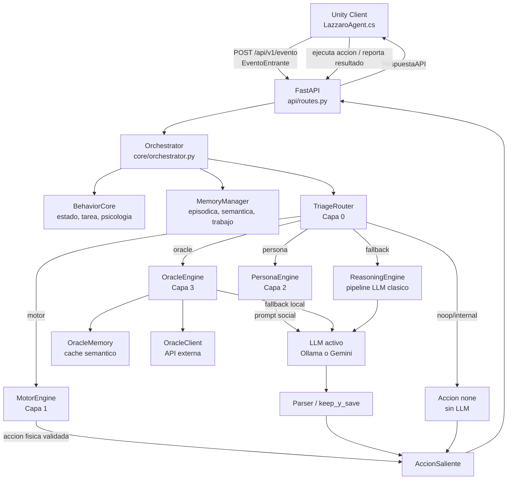
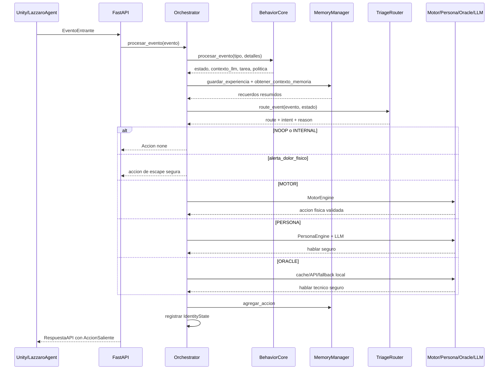
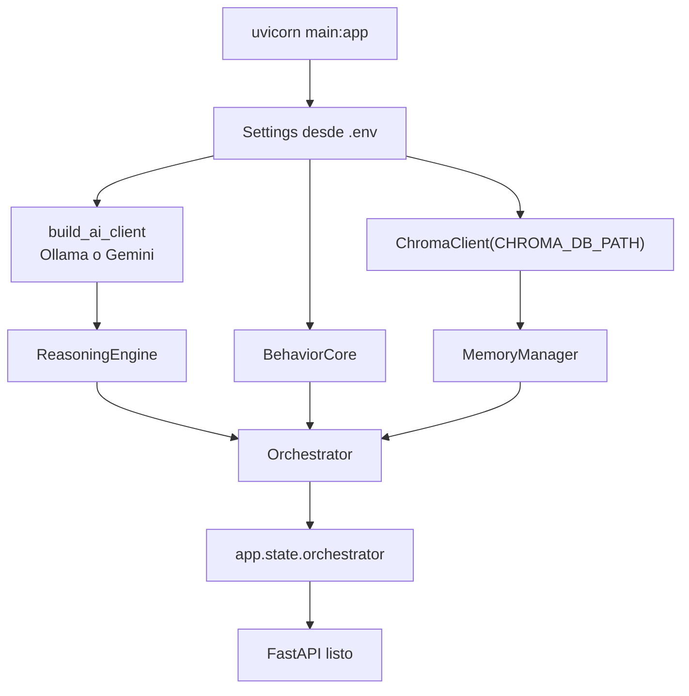
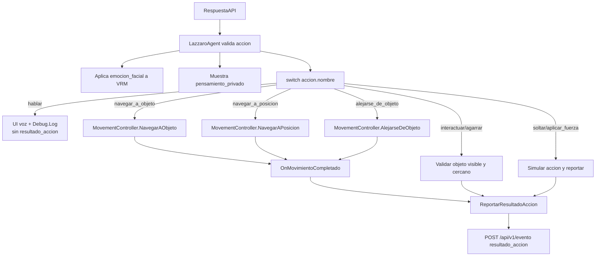

# Arquitectura Completa De Lazzaro

Documento para explicar el proyecto a un colaborador tecnico. Describe carpetas,
archivos, contratos de entrada/salida y flujo general entre Unity y Python.

> Nota de seguridad: no compartir el contenido real de `.env`. Este documento
solo describe que variables espera el sistema, sin exponer claves.

## Resumen Ejecutivo

Lazzaro es un agente cognitivo encarnado. Unity funciona como el cuerpo y jardin
de pruebas: percibe objetos, ejecuta movimiento NavMesh, muestra habla, gestiona
expresiones VRM y reporta resultados. Python funciona como cerebro: recibe
eventos REST, actualiza estado y memoria, clasifica la intencion, decide una
accion segura y devuelve una respuesta estructurada.

El backend esta organizado en capas:

- Capa 0, Triage: decide si un evento se ignora, se procesa internamente o se envia a una capa especializada.
- Capa 1, Motor: valida comandos fisicos y resuelve acciones simples sin LLM cuando puede.
- Capa 2, Persona: maneja conversacion social, identidad, estado biologico y memoria.
- Capa 3, Oraculo: maneja preguntas tecnicas/complejas con cache semantico, API externa y fallback local.
- Fallback general, ReasoningEngine: conserva el pipeline historico de prompt + LLM + parser para casos no especializados.

## Diagrama General



## Flujo De Un Evento



## Contrato Principal De Datos

### EventoEntrante

Llega desde Unity, Roblox, sandbox u otro cliente.

Entrada esperada:

```json
{
  "origen": "unity",
  "tipo_evento": "comando_usuario",
  "id_transaccion": "uuid",
  "objeto_involucrado": "ninguno",
  "detalles": {}
}
```

Campos relevantes de `detalles`:

- `mensaje`: texto del usuario o manual inicial.
- `solicita_decision`: `true` si una telemetria pasiva debe pedir decision.
- `objetos_visibles`: resumen textual de Unity.
- `resumen_percepcion`: duplicado legible de percepcion.
- `cantidad_objetos_visibles`: numero de objetos detectados.
- `posicion_lazzaro`: `{x, y, z}`.
- `objeto_mas_cercano`: `{nombre, distancia}`.
- `accion`, `exito`, `mensaje_resultado`: usados en `resultado_accion`.
- `mensaje_critico`, `direccion_escape`, `distancia_escape`: usados en `alerta_dolor_fisico`.

Tipos de evento principales:

- `inicio_simulacion`: Unity despierta al agente y envia el manual espacial una sola vez.
- `actualizacion_estado`: telemetria pasiva; normalmente se corta en triage y no llama al LLM.
- `comando_usuario`: instruccion directa del usuario; pasa por triage.
- `resultado_accion`: reporte interno de Unity; normalmente se procesa sin LLM.
- `alerta_dolor_fisico`: interrupcion critica; genera accion segura inmediata.

### AccionSaliente

Sale desde Python hacia Unity.

```json
{
  "id_accion": "uuid",
  "nombre": "hablar",
  "parametros": {"texto_a_comunicar": "texto"},
  "razonamiento": "motivo breve",
  "pensamiento_privado": "debug interno",
  "requiere_confirmacion": false,
  "emocion_facial": "Fcl_ALL_Neutral"
}
```

Acciones principales actuales:

- `none`: no hacer nada.
- `hablar`: mostrar voz/UI en Unity, sin reportar resultado para evitar bucles.
- `navegar_a_objeto`: moverse hacia un objeto visible.
- `navegar_a_posicion`: moverse hacia coordenadas.
- `alejarse_de_objeto`: retroceder respecto a un objeto.
- `interactuar_objeto_3d`: mirar/tocar/inspeccionar/golpear/usar/activar.
- `agarrar_objeto`: agarrar un objeto cercano.
- `soltar_objeto`: soltar objeto sostenido.
- `aplicar_fuerza`: aplicar fuerza simulada a un objeto.

## Carpetas Principales

| Carpeta | Responsabilidad | Recibe | Entrega |
|---|---|---|---|
| `ai_engine/` | Clientes LLM, prompts, triage, capas motor/persona/oraculo y parser. | Contexto del core, memoria, herramientas, mensajes de usuario. | `ActionResponse`, prompts, decisiones de ruta, texto LLM. |
| `api/` | API REST FastAPI y modelos HTTP. | Requests JSON de clientes externos. | `RespuestaAPI`, estado publico, notificaciones, constelacion. |
| `config/` | Configuracion por `.env`/Pydantic. | Variables de entorno. | Objeto `Settings`. |
| `core/` | Orquestador central, estado emocional, tarea, personalidad, psicologia. | `EventoEntrante` y detalles. | Estado interno, contexto LLM, `AccionSaliente`. |
| `memory/` | Memoria episodica, semantica, trabajo y ChromaDB. | Narrativas, reglas, consultas. | Recuerdos recuperados, resumen de memoria, registros persistidos. |
| `telescopio/` | Modelo de constelacion cognitiva para visualizar estado y relaciones. | Estado bruto, rasgos, banderas, contexto. | Grafo serializable de nodos/enlaces. |
| `tools/` | Registro y ejecucion de herramientas. | Acciones y parametros. | `ToolResult` o strings de confirmacion. |
| `unity_client/` | Scripts C# del cuerpo de Lazzaro en Unity. | Respuestas API y eventos de usuario/fisica. | Eventos HTTP, movimiento, UI, expresiones, reportes. |
| `docs/` | Bitacoras y documentacion tecnica. | Cambios del proyecto. | Markdown compartible. |
| `lazzaro_data/` | Datos persistentes ChromaDB. | Escrituras de memoria/cache. | No es codigo; no debe editarse manualmente. |

## Flujo Cognitivo Por Ruta

### NOOP / INTERNAL

Entrada tipica:

- `actualizacion_estado`
- `resultado_accion`
- evento desconocido

Salida:

- `ActionResponse(accion="none")`
- no llama al LLM
- aun actualiza `BehaviorCore`, memoria e `IdentityState`

### MOTOR

Entrada tipica:

- "camina hacia el cubo"
- "alejate de la sphere"
- "ve a x=1 y=0 z=3"

Proceso:

- `TriageRouter` detecta intencion fisica.
- `MotorEngine` intenta resolver localmente con percepcion.
- Si no puede, cae al `ReasoningEngine`.
- Cualquier accion motora propuesta pasa por validacion estricta con Pydantic.

Salida:

- accion fisica validada o `none`.

### PERSONA

Entrada tipica:

- "hola"
- "como te sientes?"
- "te gusta tu nombre?"

Proceso:

- `PersonaEngine.preparar_interaccion(...)` crea mensajes tipo chat.
- Inyecta `IdentityState`, percepcion y recuerdos.
- Se llama al LLM activo.
- `PersonaEngine.parsear_respuesta(...)` fuerza JSON y accion `hablar`.

Salida:

- siempre `hablar` seguro con `texto_a_comunicar`.

### ORACLE

Entrada tipica:

- preguntas tecnicas, codigo, filosofia, debugging, arquitectura, matematicas.

Proceso:

- `OracleEngine.evaluar_cache(...)`.
- Si hay cache HIT, responde sin LLM.
- Si no hay cache, `OracleClient` intenta API externa.
- Si la API externa falla o no esta configurada, usa Ollama local.
- `OracleEngine.keep_y_save(...)` limpia JSON, fuerza `hablar` y guarda cache.

Salida:

- `hablar` con respuesta tecnica.
- si hubo fallo externo o fallback de rescate, `IdentityState` aumenta estres.

## Inventario De Archivos

### Raiz

| Archivo | Hace | Recibe | Sale |
|---|---|---|---|
| `main.py` | Punto de entrada FastAPI. Carga settings, memoria, cliente LLM, herramientas y orquestador. | Variables `.env`, imports de herramientas, ciclo de vida FastAPI. | App `FastAPI` con rutas `/api/v1/*`; cierra memoria/cliente al apagar. |
| `README.md` | Resumen minimo y enlaces de documentacion. | Ninguna entrada runtime. | Texto para humanos. |
| `requirements.txt` | Dependencias Python: FastAPI, Uvicorn, Pydantic, google-genai, ChromaDB, httpx. | Instalador/pip. | Entorno Python reproducible. |
| `.env` | Configuracion local secreta. | Claves/modelos/puertos. | Valores para `Settings`; no compartir contenido. |
| `.gitignore` | Reglas de exclusion Git. | Nombres/patrones de archivo. | Evita versionar logs, `.env`, pyc. |
| `lazzaro.log` | Log generado en runtime. | Mensajes del logger. | Archivo de diagnostico; no es fuente. |
| `teses.py` | Script de prueba/manual antiguo para probar cerebro. | Ejecucion manual. | Resultados por consola. |
| `to-do` | Archivo vacio de pendientes. | Ninguna. | Ninguna. |

### `api/`

| Archivo | Hace | Recibe | Sale |
|---|---|---|---|
| `api/__init__.py` | Marca la carpeta como paquete Python. | Imports. | Paquete `api`. |
| `api/schemas.py` | Define modelos Pydantic HTTP. | JSON externo. | `EventoEntrante`, `AccionSaliente`, `RespuestaAPI`, `EstadoAgente`, `NotificacionSaliente`. |
| `api/routes.py` | Define endpoints REST. | Requests FastAPI. | Respuestas API, estado publico, notificaciones, constelacion. |

Endpoints:

- `POST /api/v1/evento`: entrada principal de Unity/Roblox/sandbox.
- `GET /api/v1/estado`: snapshot publico del estado.
- `GET /api/v1/notificaciones`: vacia y devuelve notificaciones espontaneas.
- `GET /api/v1/constelacion`: devuelve grafo cognitivo.
- `POST /api/v1/comando`: fuerza evento como `comando_usuario`.

### `config/`

| Archivo | Hace | Recibe | Sale |
|---|---|---|---|
| `config/settings.py` | Centraliza configuracion por Pydantic Settings. | `.env`/variables de entorno. | `Settings` con `AI_PROVIDER`, Gemini, Ollama, Oracle y Chroma. |

Variables importantes:

- `AI_PROVIDER`: `ollama` o `gemini`.
- `OLLAMA_HOST`, `OLLAMA_PORT`, `OLLAMA_BASE_URL`, `OLLAMA_MODEL_NAME`, `DEEPSEEK_MODEL`.
- `GEMINI_API_KEY`, `GEMINI_MODEL_NAME`, `GEMINI_TEMPERATURE`, `GEMINI_MAX_TOKENS`.
- `ORACLE_API_URL`, `ORACLE_API_KEY`, `ORACLE_MODEL`, `ORACLE_TIMEOUT`.
- `CHROMA_DB_PATH`.

### `core/`

| Archivo | Hace | Recibe | Sale |
|---|---|---|---|
| `core/__init__.py` | Marca paquete. | Imports. | Paquete `core`. |
| `core/logger.py` | Configura logging a consola y `lazzaro.log`. | Nombre de logger. | `Logger`. |
| `core/orchestrator.py` | Cerebro central. Coordina behavior, memoria, triage, capas cognitivas, herramientas e identidad. | `EventoEntrante`. | `AccionSaliente` o `None`; notificaciones; estado publico. |
| `core/behavior_core.py` | Integra estado, personalidad, tarea, psicologia y constelacion. | Tipo de evento + detalles. | Contexto LLM, narrativa, politica, tarea, percepcion resumida, constelacion. |
| `core/state_engine.py` | Variables emocionales/cognitivas crudas y decaimiento temporal. | Eventos emocionales e intensidad. | Diccionario de estado, foco efectivo, resiliencia. |
| `core/task_context.py` | Administra objetivo activo, intentos, fallos, frustracion, loops y compulsiones. | Acciones ejecutadas y exito/fallo. | Resumen de tarea y banderas de patrones. |
| `core/personality.py` | Rasgos moldeables: resiliencia, impulsividad, paciencia, sociabilidad, metodo. | Eventos e intensidad emocional. | Rasgos y modificadores para `StateEngine`. |
| `core/psychology.py` | Traduce numeros a narrativa, etiquetas y banderas. | `StateEngine`, personalidad, tarea, percepcion. | `contexto_llm` y resumen narrativo. |

### `ai_engine/`

| Archivo | Hace | Recibe | Sale |
|---|---|---|---|
| `ai_engine/__init__.py` | Marca paquete. | Imports. | Paquete `ai_engine`. |
| `ai_engine/ai_client.py` | Interfaz abstracta para clientes LLM. | Prompt y kwargs. | Texto generado y health check. |
| `ai_engine/client_factory.py` | Construye cliente segun `AI_PROVIDER`. | `Settings`. | `OllamaClient` o `GeminiClient`. |
| `ai_engine/ollama_client.py` | Cliente local para Ollama/DeepSeek. | Prompt plano, parametros de generacion. | Texto crudo del modelo; limpia `<think>`. |
| `ai_engine/gemini_client.py` | Cliente Google Gemini con `google.genai`, reintentos y rate limit. | Prompt y config. | Texto crudo Gemini. |
| `ai_engine/reasoning_engine.py` | Pipeline LLM general historico. | `contexto_llm`, memoria, herramientas, politica, tarea. | `ActionResponse`. |
| `ai_engine/context_builder.py` | Convierte contexto dict en `AgentContext`. | Estado, memoria, herramientas, politica. | `AgentContext`. |
| `ai_engine/prompt_builder.py` | Ensambla prompt desde plantillas. | `AgentContext`. | Prompt plano. |
| `ai_engine/response_parser.py` | Extrae/valida JSON del LLM general. | Texto crudo LLM y acciones permitidas. | `ActionResponse`. |
| `ai_engine/schemas.py` | Modelos internos de prompt y respuesta. | Datos internos. | `AgentContext`, `PromptSections`, `LLMResponse`, `ActionResponse`. |
| `ai_engine/llm_policies.py` | Ajusta temperatura, tokens y riesgo por politica. | Politica, proveedor, herramientas. | Parametros de generacion y herramientas filtradas. |
| `ai_engine/tool_router.py` | Filtra herramientas por tarea/politica/riesgo. | Lista de herramientas, objetivo, politica. | Herramientas permitidas/riesgosas. |
| `ai_engine/intent_types.py` | Taxonomia de intenciones y rutas. | Ninguna runtime. | `IntentType`, `Route`, `INTENT_TO_ROUTE`. |
| `ai_engine/routing_rules.py` | Reglas por keywords para clasificar texto. | Mensaje usuario. | `IntentType`. |
| `ai_engine/triage_router.py` | Capa 0: decide ruta de cada evento. | Evento como dict y estado. | Decision con `intent`, `route`, `confidence`, `reason`. |
| `ai_engine/spatial_reasoner.py` | Razonamiento espacial determinista. | Percepcion Unity y texto. | Objetos, distancias, nombres extraidos. |
| `ai_engine/motor_schemas.py` | Esquemas estrictos de acciones fisicas. | Parametros motores. | Parametros validados o error Pydantic. |
| `ai_engine/motor_engine.py` | Capa 1 motora. Resuelve/valida comandos fisicos. | Mensaje usuario, percepcion, herramientas. | Dict `MotorAction` o `none`. |
| `ai_engine/identity_state.py` | Estado biologico social: energia, estres, enfoque. | Ruta, intencion, exito, descanso, intensidad. | Estado cualitativo y bloque para prompt social. |
| `ai_engine/persona_prompt_buider.py` | Construye prompt de identidad/persona. | Estado biologico, percepcion, recuerdos. | Prompt system social. |
| `ai_engine/persona_engine.py` | Capa 2 social. Prepara interaccion y parsea salida. | Mensaje usuario, `IdentityState`, percepcion, recuerdos, texto LLM. | Dict seguro con accion `hablar`. |
| `ai_engine/oracle_client.py` | Cliente API externa del Oraculo. | Mensajes chat `{role, content}`. | Texto crudo o `None`. |
| `ai_engine/oracle_memory.py` | Cache semantico independiente del Oraculo en Chroma. | Pregunta/respuesta. | Respuesta cacheada o guardado en `oracle_cache`. |
| `ai_engine/oracle_engine.py` | Capa 3 Oraculo. Prepara consulta, valida JSON, guarda cache. | Mensaje usuario, respuesta cruda, `OracleMemory`. | Dict seguro con accion `hablar`. |
| `ai_engine/test_persona.py` | Prueba manual de PersonaEngine. | Ejecucion directa. | Assertions/prints. |

Nota: `persona_prompt_buider.py` conserva el typo `buider`; funciona porque
`persona_engine.py` lo importa con ese nombre. Conviene renombrarlo en una
limpieza futura coordinada.

### `ai_engine/prompts/`

| Archivo | Hace | Recibe | Sale |
|---|---|---|---|
| `system_prompt.txt` | Reglas base del sistema cognitivo general. | Inyeccion por `PromptBuilder`. | Bloque system. |
| `local_system_prompt.txt` | Reglas de oro para Ollama/local, identidad viva, turnos y expresiones. | Nombre y contexto local. | Bloque system adicional. |
| `personality_prompt.txt` | Explica rasgos de personalidad al LLM general. | `{rasgos}`. | Bloque de personalidad. |
| `estado_prompt.txt` | Explica estado emocional/cognitivo. | `{estado_narrativo}`. | Bloque emocional. |
| `memoria_prompt.txt` | Inyecta recuerdos relevantes. | `{memoria}`. | Bloque de memoria. |
| `tool_prompt.txt` | Lista herramientas disponibles y reglas de uso. | `{herramientas}`. | Bloque de herramientas. |
| `format_prompt.txt` | Define JSON obligatorio del LLM general. | Ninguna dinamica. | Instrucciones de formato. |

### `memory/`

| Archivo | Hace | Recibe | Sale |
|---|---|---|---|
| `memory/__init__.py` | Marca paquete. | Imports. | Paquete `memory`. |
| `memory/chroma_client.py` | Wrapper tolerante a fallos de ChromaDB. | Documentos, metadata, queries, filtros. | Resultados, conteos, eliminaciones. |
| `memory/memory_types.py` | Dataclasses de memoria. | Datos crudos. | `EpisodicMemory`, `SemanticMemory`, `MemoryDocument`, `MemoryResult`. |
| `memory/memory_encoder.py` | Codifica eventos/reglas a documentos. | Narrativa, estado, metadata. | Recuerdos y documentos Chroma. |
| `memory/episodic_memory.py` | Store de experiencias concretas. | `EpisodicMemory`, queries. | `MemoryResult` episodicos. |
| `memory/semantic_memory.py` | Store de reglas/patrones. | `SemanticMemory`, queries. | `MemoryResult` semanticos. |
| `memory/memory_retriever.py` | Recuperador hibrido episodico+semantico con reranking. | Query y filtros. | Lista ordenada de recuerdos. |
| `memory/memory_summarizer.py` | Resume recuerdos para prompt. | `MemoryResult[]`. | Texto compacto. |
| `memory/memory_filters.py` | Fabrica filtros Chroma. | Tipo, valencia, impacto, recencia. | Dict `where`. |
| `memory/memory_decay.py` | Calcula relevancia temporal/uso. | Recuerdo, accesos, fechas. | Pesos e indicador de descarte. |
| `memory/working_memory.py` | Cola RAM de acciones recientes. | Accion, resultado, detalles. | Resumen de ultimas acciones. |
| `memory/memory_manager.py` | Fachada de memoria. Coordina stores, retriever, summarizer y compactacion. | Experiencias, reglas, queries. | IDs guardados, contexto de memoria, acciones recientes. |

### `tools/`

| Archivo | Hace | Recibe | Sale |
|---|---|---|---|
| `tools/__init__.py` | Marca paquete. | Imports. | Paquete `tools`. |
| `tools/base.py` | Resultado estandar de herramientas. | Exito/mensaje/error/datos. | `ToolResult`. |
| `tools/registry.py` | Registro global por decoradores. | Nombre, descripcion, schema, funcion. | Catalogo de herramientas y descripciones. |
| `tools/executor.py` | Ejecuta herramientas localmente si aplica. | `AccionSaliente`. | `ToolResult`. |

#### `tools/simulated/`

| Archivo | Hace | Recibe | Sale |
|---|---|---|---|
| `tools/simulated/__init__.py` | Marca paquete. | Imports. | Paquete simulado. |
| `tools/simulated/movimiento_sim.py` | Registra navegacion semantica para Unity. | `nombre_objeto`, coordenadas o distancia. | String de confirmacion. |
| `tools/simulated/interaccion_sim.py` | Registra interaccion 3D y hablar. | Objeto, tipo de accion, fuerza, texto. | String de confirmacion. |
| `tools/simulated/mouse_sim.py` | Simula mouse virtual. | Coordenadas o boton. | `ToolResult`. |
| `tools/simulated/keyboard_sim.py` | Simula teclado virtual. | Texto o tecla especial. | `ToolResult`. |

Herramientas simuladas registradas:

- `navegar_a_objeto(nombre_objeto)`
- `navegar_a_posicion(x, y, z)`
- `alejarse_de_objeto(nombre_objeto, distancia)`
- `interactuar_objeto_3d(nombre_objeto, tipo_accion)`
- `agarrar_objeto(nombre_objeto)`
- `soltar_objeto(fuerza_lanzamiento)`
- `aplicar_fuerza(nombre_objeto, vector_x, vector_y, vector_z, fuerza)`
- `hablar(texto_a_comunicar)`
- `mover_mouse(x, y)`
- `click_mouse(boton)`
- `escribir_texto(texto, presionar_enter)`
- `presionar_tecla_especial(tecla)`

#### `tools/real/`

| Archivo | Hace | Recibe | Sale |
|---|---|---|---|
| `tools/real/__init__.py` | Marca paquete. | Imports. | Paquete real. |
| `tools/real/mouse_real.py` | Control real de mouse con `pyautogui`; requiere confirmacion. | Coordenadas o boton. | `ToolResult`. |
| `tools/real/keyboard_real.py` | Escritura real de teclado; requiere confirmacion. | Texto y enter opcional. | `ToolResult`. |

Estas herramientas reales no se importan en `main.py` por defecto. Deben usarse
solo en sandbox controlado.

### `telescopio/`

| Archivo | Hace | Recibe | Sale |
|---|---|---|---|
| `telescopio/__init__.py` | Marca paquete. | Imports. | Paquete `telescopio`. |
| `telescopio/constelacion_cognitiva.py` | Modelo de grafo cognitivo con nodos/enlaces/contexto. | Estado, rasgos, banderas, contexto. | Dict/JSON/resumen de constelacion. |

### `unity_client/`

| Archivo | Hace | Recibe | Sale |
|---|---|---|---|
| `unity_client/DTOs.cs` | Contrato C# equivalente a schemas API. | JSON del backend o datos para enviar. | Objetos `EventoEntrante`, `RespuestaAPI`, `AccionSaliente`. |
| `unity_client/ApiClient.cs` | Cliente HTTP Unity. | `EventoEntrante`. | Callback `RespuestaAPI` o error de conexion/parseo. |
| `unity_client/PerceptionSystem.cs` | Escanea entorno con campo visual frontal. | Colliders con tag `Interactuable`, posicion propia. | Dict de percepcion comprimida. |
| `unity_client/MovementController.cs` | Ejecuta movimiento con NavMeshAgent. | Orden de objeto/posicion/alejarse. | Evento `OnMovimientoCompletado(bool, string)`. |
| `unity_client/LazzaroAgent.cs` | Coordinador Unity. Cola eventos/tareas, latido, respuesta, habla, VRM, reportes. | Input usuario, percepcion, respuesta backend, colisiones/dolor. | Eventos al backend, UI, movimiento, expresiones, reportes de accion. |

Detalles importantes de Unity:

- `LazzaroAgent.Start()` envia `inicio_simulacion` con manual espacial.
- `LatidoCognitivo()` corre cada 1s, pero solo envia `actualizacion_estado` si hay cambio significativo o movimiento terminado.
- `actualizacion_estado` no envia el manual espacial; eso evita resetear la tarea.
- `hablar` no reporta `resultado_accion`; eso evita el bucle de voz.
- `ReportarDolor(...)` manda `alerta_dolor_fisico` con prioridad maxima.
- La cola de tareas divide comandos con `luego`, `despues`, `después`, `finalmente`, etc.
- `TryBuscarObjetoCercano(...)` evita reportar exito falso al agarrar/interactuar con objetos ausentes o lejanos.

### `docs/`

| Archivo | Hace | Recibe | Sale |
|---|---|---|---|
| `docs/registro_pruebas_unity.md` | Bitacora de fases, bugs, pruebas y riesgos. | Resultados de pruebas y cambios. | Registro historico. |
| `docs/arquitectura_completa_lazzaro.md` | Este documento. | Codigo fuente del proyecto. | Mapa tecnico compartible. |

### Datos Generados

| Ruta | Hace | Recibe | Sale |
|---|---|---|---|
| `lazzaro_data/` | Persistencia ChromaDB de `experiencias` y `oracle_cache`. | Memoria episodica, semantica y respuestas del Oraculo. | Resultados semanticos. |
| `__pycache__/` | Cache Python generado automaticamente. | Imports Python. | `.pyc`; ignorar. |
| `.git/` | Metadata Git. | Commits/branches. | Historial Git. |
| `lazzaro.log` | Log runtime. | Mensajes `core.logger`. | Diagnostico textual. |

## Inicializacion Del Sistema



## Ejecucion De Acciones En Unity



## Puntos De Extension

- Para agregar una herramienta: crear un schema Pydantic y decorar la funcion con `ToolRegistry.register(...)`.
- Para agregar una accion fisica en Unity: registrar herramienta Python, agregar schema motor, agregar handler en `LazzaroAgent.cs`, y si requiere movimiento, extender `MovementController.cs`.
- Para cambiar LLM activo: editar `.env`/`Settings.AI_PROVIDER` y revisar `ai_engine/client_factory.py`.
- Para mejorar triage: ajustar `routing_rules.py` o reemplazar `TriageRouter.route_event(...)` por un clasificador mas robusto.
- Para limpiar prompts: editar `ai_engine/prompts/*.txt` o `persona_prompt_buider.py`.
- Para depurar memoria: revisar `lazzaro_data/`, `memory_manager.py` y endpoint `/api/v1/constelacion`.

## Riesgos Y Notas Actuales

- `.env` contiene secretos locales; nunca copiarlo a documentacion compartida.
- `persona_prompt_buider.py` tiene typo en el nombre, pero el import actual depende de ese typo.
- `routing_rules.py` usa keywords y puede clasificar mal frases ambiguas.
- `OracleClient` asume proveedor compatible con formato OpenAI/Groq y `response_format`.
- `tools/real/*` controla mouse/teclado real si se importa; mantener fuera del arranque normal salvo sandbox.
- Unity necesita objetos con tag `Interactuable` y NavMesh valido para movimiento.
- `lazzaro_data/` es estado persistente; borrarlo cambia memoria y cache del Oraculo.

## Checklist Para Explicarselo A Un Companero

1. Mostrar este documento y el diagrama general.
2. Explicar que Unity no decide inteligencia: percibe y ejecuta.
3. Explicar que Python no mueve directamente el avatar: devuelve acciones estructuradas.
4. Recorrer `core/orchestrator.py`: ahi se ve el flujo real.
5. Recorrer `ai_engine/triage_router.py`: ahi se decide la capa.
6. Recorrer `ai_engine/motor_engine.py`, `persona_engine.py`, `oracle_engine.py`: ahi viven las tres rutas.
7. Recorrer `unity_client/LazzaroAgent.cs`: ahi se ve como se ejecuta la respuesta.
8. Revisar `docs/registro_pruebas_unity.md` para entender por que se tomaron decisiones de estabilidad.
