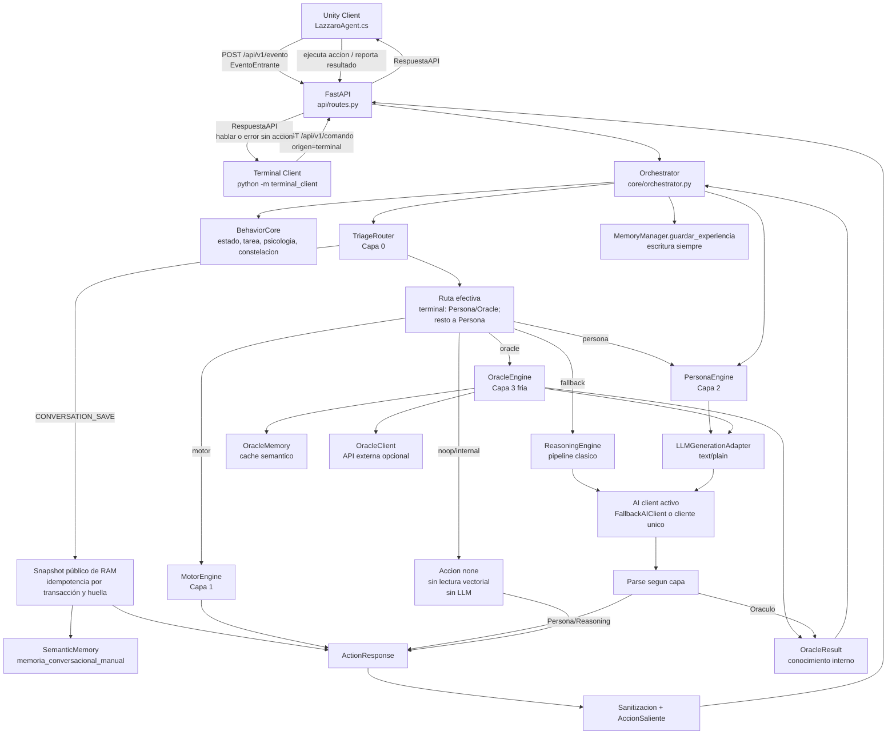
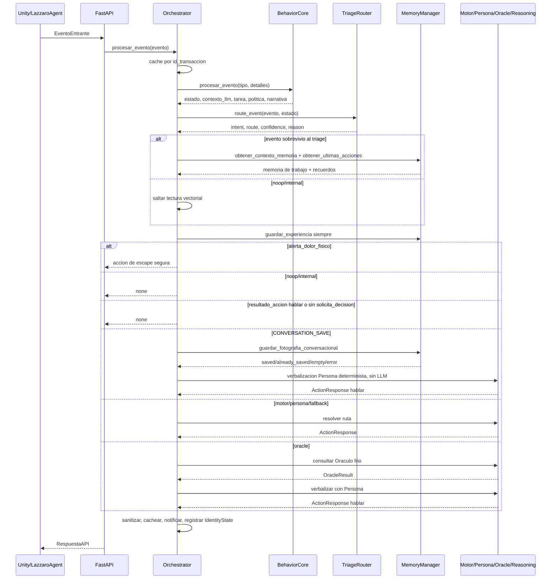
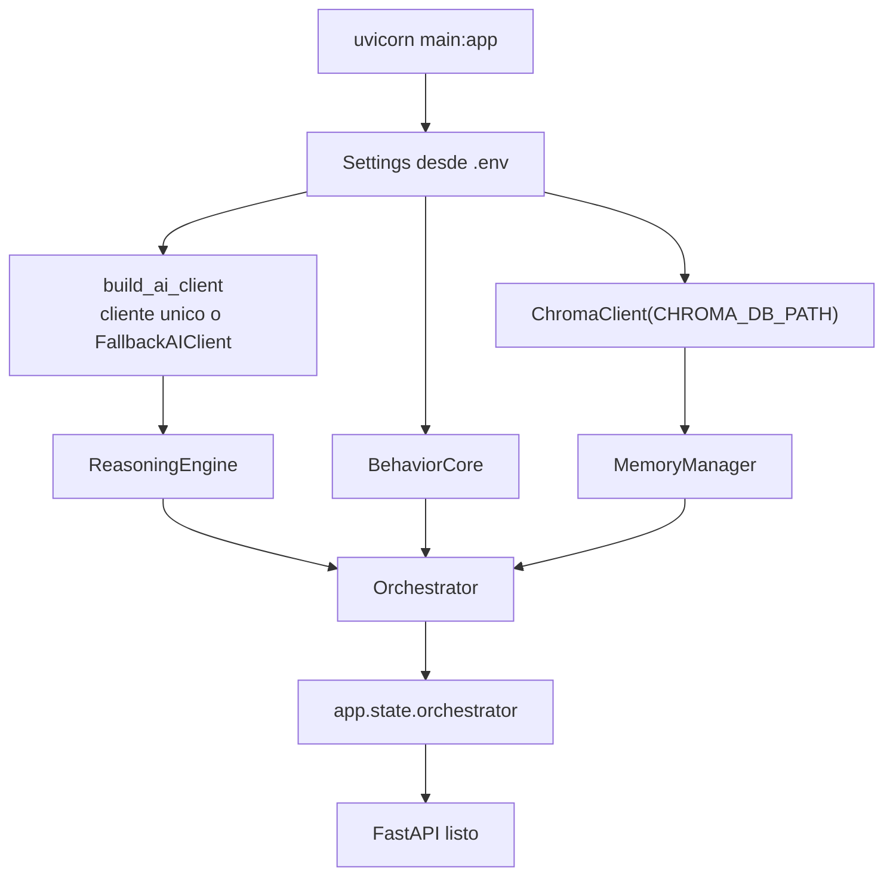
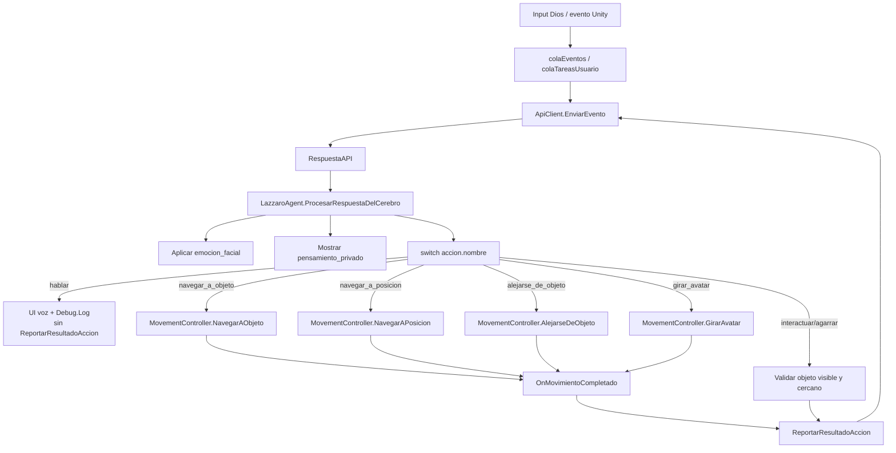
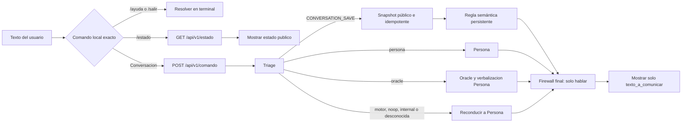

# Arquitectura Completa De Lazzaro

Actualizado: 2026-07-29

Documento para explicar el proyecto a un colaborador tecnico. Describe carpetas,
archivos, contratos de entrada/salida y flujo actual entre Unity, terminal y
Python.

> Nota de seguridad: no compartir el contenido real de `.env`. Este documento
> solo describe que variables espera el sistema, sin exponer claves.

## Resumen Ejecutivo

Lazzaro es un agente cognitivo encarnado. Unity funciona como cuerpo y jardin
de pruebas: percibe objetos, ejecuta movimiento NavMesh, muestra habla, aplica
expresiones VRM y reporta resultados fisicos. Python funciona como cerebro:
recibe eventos REST, actualiza estado, escribe memoria, clasifica intencion,
elige una capa cognitiva y devuelve una accion estructurada.

`terminal_client/` es un segundo frontend, exclusivamente conversacional, para
usar ese mismo cerebro y memoria con Unity cerrado. También puede solicitar,
mediante dos frases naturales, una fotografía persistente de la conversación
que continúa en RAM.

La prioridad actual del sistema es estabilidad con bajo consumo:

- La telemetria pasiva se guarda en memoria, pero no consulta memoria vectorial
  ni llama al LLM si Triage la corta.
- La conversacion social no puede emitir acciones fisicas.
- Los comandos motores incompletos piden aclaracion antes de inventar objetos.
- Las rutas costosas usan caches y fallbacks para evitar bloqueos por un solo
  proveedor LLM.
- Unity evita bucles: `hablar` no genera `resultado_accion`.

## Capas Cognitivas

| Capa | Modulo principal | Responsabilidad | LLM |
|---|---|---|---|
| Capa 0 | `ai_engine/triage_router.py` | Clasifica eventos y reconoce la intención especial `CONVERSATION_SAVE`. | No |
| Capa 1 | `ai_engine/motor_engine.py` | Resuelve y valida comandos fisicos. | Solo fallback si el motor determinista no basta |
| Capa 2 | `ai_engine/persona_engine.py` | Conversacion, identidad, estado biologico y unica voz publica social; verbaliza determinísticamente el guardado manual. | Si en conversación normal; no en la rama de guardado |
| Capa 3 | `ai_engine/oracle_engine.py` | Preguntas tecnicas/complejas con cache semantico; produce `OracleResult` frio. | Si, con cache y fallback |
| Fallback | `ai_engine/reasoning_engine.py` | Pipeline historico de prompt + LLM + parser. | Si |

## Diagrama General



## Flujo Real De Un Evento



Punto clave: el sistema separa lectura y escritura de memoria. Todos los eventos
se escriben por el flujo episódico normal; solo los eventos relevantes leen
memoria vectorial para ahorrar latencia y tokens. `CONVERSATION_SAVE` es una
excepción explícita: además del evento normal, escribe una fotografía semántica
sin consultar contexto largo, llamar al LLM ni activar consolidación.

## Contrato Principal De Datos

### EventoEntrante

Llega desde Unity, Roblox, sandbox, terminal u otro cliente.

```json
{
  "origen": "unity",
  "tipo_evento": "comando_usuario",
  "id_transaccion": "uuid",
  "objeto_involucrado": "ninguno",
  "detalles": {}
}
```

Campos frecuentes en `detalles`:

| Campo | Uso |
|---|---|
| `mensaje` | Texto del usuario, manual inicial o texto de subtarea. |
| `solicita_decision` | Si `true`, una telemetria puede pedir decision. Default practico: `false`. |
| `objetos_visibles` | Resumen textual o lista comprimida de percepcion Unity. |
| `objetos_normalizados` | Lista compatible con `PerceivedObject` para grounding de Capa 1. |
| `snapshot_id`, `source` | Identidad y origen del snapshot perceptivo. |
| `unknown_affordances` | Affordances rechazadas por el schema cerrado. |
| `resumen_percepcion` | Texto legible de percepcion frontal. |
| `cantidad_objetos_visibles` | Conteo de objetos detectados. |
| `posicion_lazzaro` | Coordenadas `{x, y, z}`. |
| `objeto_mas_cercano` | Objeto destacado para razonamiento espacial. |
| `accion`, `exito`, `mensaje_resultado` | Resultado de accion ejecutada por Unity. |
| `mensaje_critico` | Descripcion de dolor, choque o interrupcion. |
| `direccion_escape`, `distancia_escape` | Parametros para escape fisico inmediato. |

Tipos de evento principales:

| Tipo | Intencion |
|---|---|
| `inicio_simulacion` | Despertar inicial. Unity puede mandar manual espacial una sola vez. |
| `actualizacion_estado` | Telemetria pasiva. Normalmente Triage la corta. |
| `comando_usuario` | Texto del usuario: instruccion en Unity o conversación normal en terminal. Pasa por Triage. |
| `resultado_accion` | Reporte interno de Unity. Normalmente no llama al LLM. |
| `alerta_dolor_fisico` | Interrupcion critica. Prioridad maxima, sin LLM. |

### AccionSaliente

Sale desde Python hacia Unity u otro cliente. Terminal solo acepta una
`AccionSaliente` cuyo nombre sea `hablar`.

```json
{
  "id_accion": "uuid",
  "nombre": "hablar",
  "parametros": {"texto_a_comunicar": "texto"},
  "razonamiento": "motivo breve",
  "pensamiento_privado": "debug interno",
  "requiere_confirmacion": false,
  "emocion_facial": "Fcl_ALL_Neutral"
}
```

Acciones actuales:

| Accion | Parametros principales | Ejecuta |
|---|---|---|
| `none` | `{}` | No hace nada. |
| `hablar` | `texto_a_comunicar` | Unity muestra voz/log; terminal imprime el texto público. No reporta resultado. |
| `navegar_a_objeto` | `nombre_objeto` | NavMesh hacia objeto visible. |
| `navegar_a_posicion` | `x`, `y`, `z` | NavMesh hacia coordenadas. |
| `alejarse_de_objeto` | `nombre_objeto`, `distancia` | Punto opuesto al objeto. |
| `girar_avatar` | `grados` | Rotacion relativa en Y. |
| `cancelar_tarea` | `cancelar_movimiento`, `cancelar_cola` | Detiene movimiento, cola y contexto en Unity. |
| `interactuar_objeto_3d` | `nombre_objeto`, `tipo_accion` | Valida proximidad y reporta; el efecto de dominio sigue como stub. |
| `agarrar_objeto` | `nombre_objeto` | Valida proximidad y reporta; todavía no sujeta físicamente el objeto. |
| `soltar_objeto` | `fuerza_lanzamiento` | Reporta el contrato; todavía no mantiene un objeto agarrado real. |
| `aplicar_fuerza` | `nombre_objeto`, `vector_x`, `vector_y`, `vector_z`, `fuerza` | Reporta parámetros; todavía no aplica fuerza a un `Rigidbody`. |

## Carpetas Principales

| Carpeta | Responsabilidad | Recibe | Entrega |
|---|---|---|---|
| `ai_engine/` | Clientes LLM, prompts, triage, motor, persona, oracle y parser. | Contexto, memoria, herramientas, mensajes. | `ActionResponse`, prompts, rutas, texto LLM. |
| `api/` | API REST FastAPI y modelos HTTP. | JSON de clientes externos. | `RespuestaAPI`, estado, notificaciones, constelacion. |
| `config/` | Configuracion por `.env`/Pydantic. | Variables de entorno. | `Settings`. |
| `core/` | Orquestador, estado, tarea, personalidad, psicologia, politica de herramientas. | `EventoEntrante`. | Estado interno y `AccionSaliente`. |
| `memory/` | Memoria episodica, semantica, trabajo, consolidacion y ChromaDB. | Narrativas, reglas, consultas. | Recuerdos, resumenes, persistencia. |
| `telescopio/` | Modelo y visualizador de constelacion cognitiva. | Estado bruto o ChromaDB. | Grafo y HTML visual. |
| `tools/` | Registro y ejecucion de herramientas simuladas/reales. | Acciones y parametros. | `ToolResult` o confirmaciones. |
| `unity_client/` | Cuerpo Unity: percepcion, movimiento, voz, VRM, cola de tareas. | Respuestas API y eventos de usuario/fisica. | Eventos HTTP y acciones en escena. |
| `terminal_client/` | Chat de texto sin cuerpo ni comandos motores. | Texto y comandos locales de terminal. | Eventos HTTP con origen terminal y habla publica. |
| `docs/` | Bitacoras y documentacion tecnica. | Cambios del proyecto. | Markdown compartible. |
| `lazzaro_data/` | Persistencia ChromaDB. | Memoria y cache. | Base local. No editar manualmente. |

## Inicializacion Del Sistema



`main.py` importa por defecto las herramientas simuladas:

- `tools.simulated.interaccion_sim`
- `tools.simulated.keyboard_sim`
- `tools.simulated.mouse_sim`
- `tools.simulated.movimiento_sim`

Las herramientas reales de escritorio no se importan por defecto.

## Backend LLM Y Fallbacks

El punto unico para construir clientes LLM es `ai_engine/client_factory.py`.

Proveedores soportados:

- `gemini`
- `groq`
- `xai`
- `kimi`
- `deepseek_api`
- `ollama`

Variables principales:

| Variable | Uso |
|---|---|
| `AI_PROVIDER` | Proveedor principal si no se define `AI_FALLBACK_ORDER`. |
| `AI_FALLBACK_ORDER` | Orden explicito de proveedores, separado por comas. Si existe, reemplaza el orden default. |
| `LLM_FALLBACKS_ENABLED` | Si es falso, se usa solo el primer cliente valido. |
| `GEMINI_API_KEY`, `GEMINI_MODEL_NAME` | Gemini via `google.genai`. |
| `GROQ_API_KEY`, `GROQ_MODEL` | Cliente compatible OpenAI para Groq. |
| `XAI_API_KEY`, `XAI_MODEL` | Cliente compatible OpenAI para xAI. |
| `KIMI_API_KEY`, `KIMI_MODEL` | Cliente compatible OpenAI para Moonshot/Kimi. |
| `DEEPSEEK_API_KEY`, `DEEPSEEK_API_MODEL` | DeepSeek remoto. Tambien acepta alias `DEEPSEEEK_API_KEY`. |
| `OLLAMA_BASE_URL`, `OLLAMA_HOST`, `OLLAMA_PORT`, `OLLAMA_MODEL_NAME`, `DEEPSEEK_MODEL` | Ollama local. |
| `OPENAI_COMPAT_TIMEOUT` | Timeout comun para clientes compatibles OpenAI. |

Si hay mas de un cliente disponible, `build_ai_client()` devuelve
`FallbackAIClient`. Ese wrapper prueba proveedores hasta encontrar texto no
vacio. Importante: hoy el fallback opera a nivel de texto crudo, no valida JSON
semanticamente antes de aceptar una respuesta.

`LLMGenerationAdapter` centraliza llamadas textuales tipo chat para Persona y
Oracle. Convierte mensajes `{role, content}` a prompt plano y usa
`response_mime_type="text/plain"`.

## Flujo Por Ruta

### NOOP / INTERNAL

Entrada tipica:

- `actualizacion_estado`
- `resultado_accion`
- eventos pasivos o internos

Proceso:

- `BehaviorCore` actualiza estado.
- `TriageRouter` corta.
- `MemoryManager.guardar_experiencia(...)` se ejecuta igual.
- No se llama a `obtener_contexto_memoria`.
- No se llama al LLM.

Salida:

- `ActionResponse(accion="none")`

### MOTOR

Entrada tipica:

- "camina hacia el cubo"
- "alejate de la sphere"
- "gira 180 grados"
- "ve a x=1 y=0 z=3"

Proceso:

- `MotorEngine.diagnosticar_comando_usuario(...)` intenta resolver sin LLM.
- Si el comando esta listo, valida con `motor_schemas.py`.
- Si falta objetivo, responde con `hablar` pidiendo aclaracion.
- Si el motor determinista no puede resolver, usa `ReasoningEngine`.
- Cualquier accion motora generada por LLM vuelve a pasar por `MotorEngine`.

Salida:

- Accion fisica validada, `hablar` de aclaracion o `none` seguro.

### PERSONA

Entrada tipica:

- "hola"
- "como te sientes?"
- "te gusta tu nombre?"

Proceso:

- `PersonaEngine.preparar_interaccion(...)` arma mensajes tipo chat.
- Inyecta `IdentityState`, percepcion y recuerdos.
- `LLMGenerationAdapter` llama al cliente LLM.
- `PersonaEngine.parsear_respuesta(...)` tolera JSON sucio/parcial.
- Si la salida es irrecuperable, el orquestador hace un reintento breve.
- Cualquier accion distinta de `hablar` se fuerza a `hablar`.

Salida:

- Siempre una respuesta social segura con `accion="hablar"`.

### ORACLE

Entrada tipica:

- preguntas tecnicas
- codigo
- debugging
- arquitectura
- matematicas
- filosofia compleja

Proceso:

- `OracleEngine.evaluar_cache(...)` consulta `OracleMemory`.
- Si hay cache hit, devuelve `OracleResult` sin gastar API/LLM en Capa 3.
- Si no hay cache, `OracleClient` intenta API externa opcional.
- Si falla o no hay key, usa el cliente LLM activo via `LLMGenerationAdapter`.
- `OracleEngine.keep_y_save(...)` limpia la respuesta, guarda cache frio y devuelve `OracleResult`.
- `Orchestrator` pasa ese `OracleResult` a `PersonaEngine`.
- `PersonaEngine` verbaliza el conocimiento con la voz de Lazzaro.

Salida:

- Capa 3: `OracleResult` interno.
- Salida publica final: `hablar`, generado por Persona.

### Interrupcion Critica

`alerta_dolor_fisico` no depende del LLM. El orquestador intenta:

1. `navegar_a_posicion` usando posicion actual y vector de escape.
2. `alejarse_de_objeto` si hay objeto de escape.
3. `none` seguro si no hay datos suficientes.

## Memoria

`MemoryManager` es la fachada principal.

Componentes:

- `ChromaClient`: wrapper de ChromaDB con lock por ruta dentro del proceso.
- `EpisodicMemoryStore`: experiencias concretas.
- `SemanticMemoryStore`: reglas y abstracciones.
- `MemoryRetriever`: busqueda hibrida episodica + semantica.
- `MemorySummarizer`: resumen compacto para prompt.
- `WorkingMemory`: acciones recientes en RAM.
- `ConversationMemory`: pares recientes Usuario/Lazzaro, ultimo intercambio,
  temas activos, señales de continuidad y snapshot público atómico.
- Memoria relacional selectiva: apodos, identidad del usuario/creador y
  preferencias claras se guardan como reglas semanticas, no como transcripciones.
- Lectura relacional prioritaria: `MemoryManager.obtener_contexto_relacional()`
  recupera `tipo_evento="memoria_relacional"` en un bloque separado antes de
  memoria operativa y recuerdos largos.
- Higiene relacional: los hechos persistidos tienen huella estable, categoria,
  valor y estado (`activo` o `revocado`) para evitar duplicados y resolver
  correcciones como dejar de usar un apodo viejo.
- Consolidacion observacional: compacta telemetria vieja en reglas semanticas.
- Guardado conversacional manual: convierte hasta 12 pares públicos en una sola
  regla `memoria_conversacional_manual`, con transcripción, índice compacto,
  huella y recibos de transacción.

Reglas actuales:

- Todos los eventos se guardan como experiencia si es posible.
- La lectura vectorial solo ocurre cuando el evento sobrevive al triage.
- Los turnos conversacionales completos viven en RAM. Los hechos relacionales
  explícitos se promueven selectivamente; una solicitud `CONVERSATION_SAVE`
  también puede promover la fotografía pública completa.
- Cuando hay decision activa, el contexto se arma como continuidad RAM,
  memoria relacional persistente, memoria operativa y recuerdos largos.
- La memoria relacional elige el hecho mas reciente por categoria, por lo que
  una revocacion nueva puede ocultar un apodo o nombre anterior sin borrar datos.
- `resultado_accion` y `actualizacion_estado` no entran a memoria de trabajo si terminan en `none` pasivo.
- Al detectar descanso fuera del canal terminal, el orquestador llama a
  `consolidar_memorias_si_hace_falta()`.
- El guardado manual no entra al consolidador, no incrementa su batch, no
  vacía la RAM y no agrega su propio turno de control.
- Los retries del mismo ID conservan el snapshot del primer intento dentro del
  proceso y reintentan únicamente la escritura manual.
- `ChromaClient` tiene compuerta de hilos process-local; no protege contra otro proceso externo tocando la misma DB.

## Unity

Scripts principales:

- `DTOs.cs`: contrato C# equivalente a la API.
- `ApiClient.cs`: cliente HTTP con timeout configurable y parseo JSON.
- `PerceptionSystem.cs`: percepcion comprimida, resumen textual, busqueda de objetos.
- `MovementController.cs`: NavMesh para navegar, alejarse y girar.
- `LazzaroAgent.cs`: coordinador de eventos, cola, UI, VRM y reportes.

Flujo Unity:



Reglas importantes de estabilidad:

- `inicio_simulacion` envia manual espacial.
- `actualizacion_estado` no reinyecta el manual.
- El escaneo pasivo se omite mientras `MovementController.IsMoving` es true.
- `hablar` completa la subtarea localmente, pero no manda `resultado_accion`.
- `agarrar_objeto` e `interactuar_objeto_3d` validan objeto visible y distancia.
- La cola de tareas permite secuencias con separadores tipo `luego`, `despues`,
  `despues` con acento y `finalmente`.
- Riesgo pendiente: comandos unidos solo por coma pueden quedar como una sola
  subtarea.

## Terminal

`terminal_client/` reutiliza el backend normal con Unity cerrado. Cada mensaje
se envia a `/api/v1/comando` como `comando_usuario` y `origen="terminal"`.

Flujo:



Protecciones:

- `ToolPolicy` entrega solamente `hablar`.
- La cancelacion de tareas y el efecto de descanso se omiten en este origen.
- Persona sabe que no hay cuerpo disponible y no debe fingir acciones fisicas.
- El cliente no imprime pensamiento privado ni razonamiento.
- El cliente rechaza cualquier accion final distinta de `hablar`.
- El texto visible se limpia de secuencias ANSI basadas en ESC y controles
  C0/DEL.

Los turnos conservan acceso a recuerdos y entran en la RAM conversacional. Las
frases `guarda lo que hemos hablado` y
`guarda lo que tengas en ram en tu mente` activan el guardado manual después de
normalizar mayúsculas, acentos, puntuación y espacios. No existe `/guardar`.

El artefacto Random Forest desplegado aún no contiene
`CONVERSATION_SAVE`; admitir más variantes con ML requiere reentrenarlo y
validarlo. La rama actual no lee contexto vectorial, no expone herramientas y
no llama al LLM. Persiste solo Usuario/Lazzaro/timestamp y responde por Persona
de forma determinista.

La fotografía semántica no debe confundirse con el consolidador observacional.
La RAM permanece intacta y sigue siendo volátil; la memoria persistida no
repuebla el buffer al reiniciar.

La separacion de `TaskContext` también se postergó: `/estado` puede mostrar el
último mensaje como tarea, por lo que esta fase no admite uso simultáneo con
Unity.

La guia operativa completa esta en `docs/chat_terminal.md`.
La validación automatizada del chat y del guardado está aprobada; el resultado
de la prueba de campo terminal aún no se ha registrado.

## Inventario De Archivos

### Raiz

| Archivo | Hace | Recibe | Sale |
|---|---|---|---|
| `main.py` | Punto de entrada FastAPI. Carga settings, memoria, cliente LLM, herramientas y orquestador. | `.env`, imports, ciclo FastAPI. | App `FastAPI` y cierre ordenado. |
| `README.md` | Resumen y enlaces de documentacion. | Lectura humana. | Guia breve. |
| `requirements.txt` | Dependencias Python. | `pip`. | Entorno reproducible. |
| `.env` | Configuracion local secreta. | Claves/modelos/puertos. | Valores para `Settings`. |
| `.editorconfig` | Convenciones de edicion. | Editores compatibles. | Encoding/estilo consistente. |
| `.gitignore` | Reglas Git. | Patrones. | Evita versionar secretos/cache. |
| `teses.py` | Script manual antiguo. | Ejecucion directa. | Salida por consola. |
| `to-do` | Pendientes libres. | Texto humano. | Texto humano. |
| `train_triage_model.py` | Entrenamiento del clasificador de Triage. | Dataset configurado. | Modelo y métricas. |
| `segurity.sh` | Script histórico de reglas UFW; mantiene defectos señalados por la auditoría. | Shell Linux. | Reglas de firewall si se corrige y ejecuta. |
| `install-segurity-autostart.sh` | Instalador histórico del script UFW. | Shell Linux. | Configuración de arranque si se corrige. |

### `api/`

| Archivo | Hace |
|---|---|
| `api/__init__.py` | Marca paquete. |
| `api/schemas.py` | Modelos HTTP: `EventoEntrante`, `AccionSaliente`, `RespuestaAPI`, `EstadoAgente`, `NotificacionSaliente`. |
| `api/routes.py` | Endpoints `/evento`, `/estado`, `/notificaciones`, `/constelacion`, `/comando`. Usa `run_in_threadpool`. |

### `config/`

| Archivo | Hace |
|---|---|
| `config/settings.py` | Define proveedores LLM, fallbacks, Chroma, Ollama, Gemini, Groq, xAI, Kimi, DeepSeek y Oracle. Ignora extras de `.env`. |

### `core/`

| Archivo | Hace |
|---|---|
| `core/__init__.py` | Marca paquete. |
| `core/logger.py` | Logging a consola y `lazzaro.log`. |
| `core/orchestrator.py` | Cerebro central: idempotencia, retries por transacción, behavior, triage, guardado conversacional, capas, herramientas, notificaciones e identidad. |
| `core/tool_policy.py` | Politica de herramientas por ruta/origen: protege Unity y limita terminal exclusivamente a `hablar`. |
| `core/behavior_core.py` | Integra estado, personalidad, tarea, psicologia y constelacion. |
| `core/state_engine.py` | Variables emocionales/cognitivas y decaimiento temporal. |
| `core/task_context.py` | Objetivo activo, intentos, fallos, compulsiones y loops. |
| `core/personality.py` | Rasgos moldeables. |
| `core/psychology.py` | Traduce estado numerico a narrativa y contexto LLM. |

### `ai_engine/`

| Archivo | Hace |
|---|---|
| `ai_engine/__init__.py` | Marca paquete. |
| `ai_engine/ai_client.py` | Interfaz base para clientes LLM. |
| `ai_engine/client_factory.py` | Construye cliente unico o `FallbackAIClient`. |
| `ai_engine/fallback_ai_client.py` | Cadena de proveedores LLM por texto no vacio. |
| `ai_engine/openai_compatible_client.py` | Cliente `/chat/completions` para Groq/xAI/Kimi/DeepSeek. |
| `ai_engine/gemini_client.py` | Cliente Gemini con `google.genai`, reintentos y rate limits. |
| `ai_engine/ollama_client.py` | Cliente local Ollama/DeepSeek R1. |
| `ai_engine/llm_generation_adapter.py` | Adaptador comun para Persona/Oracle en modo texto. |
| `ai_engine/reasoning_engine.py` | Pipeline LLM general historico. |
| `ai_engine/context_builder.py` | Convierte dicts a `AgentContext`. |
| `ai_engine/prompt_builder.py` | Ensambla prompts desde plantillas. |
| `ai_engine/response_parser.py` | Extrae JSON y valida acciones del LLM general. |
| `ai_engine/schemas.py` | Modelos internos de prompt/respuesta, incluyendo `OracleResult`. |
| `ai_engine/llm_policies.py` | Temperatura, tokens y riesgo por politica/proveedor. |
| `ai_engine/tool_router.py` | Filtro adicional de herramientas en `ReasoningEngine`. |
| `ai_engine/intent_types.py` | Enum de intenciones y rutas, incluido `CONVERSATION_SAVE`. |
| `ai_engine/routing_rules.py` | Reglas keyword y allowlist normalizada de guardado manual. |
| `ai_engine/triage_router.py` | Capa 0 de enrutamiento; las dos frases base ganan al modelo. |
| `ai_engine/spatial_reasoner.py` | Utilidades espaciales deterministas. |
| `ai_engine/motor_schemas.py` | Esquemas estrictos de acciones fisicas. |
| `ai_engine/motor_engine.py` | Capa 1 motora. |
| `ai_engine/identity_state.py` | Energia, estres y enfoque para Persona. |
| `ai_engine/persona_prompt_buider.py` | Prompt social. Mantiene typo historico `buider`. |
| `ai_engine/persona_engine.py` | Capa 2 social, parser robusto y verbalización determinista del resultado de guardado. |
| `ai_engine/oracle_client.py` | Cliente API externa para Oraculo. |
| `ai_engine/oracle_memory.py` | Cache semantico frio del Oraculo en Chroma. |
| `ai_engine/oracle_engine.py` | Capa 3 Oraculo, normalizacion a `OracleResult` y cache. |
| `ai_engine/test_llm_fallbacks.py` | Prueba de settings/fallbacks. |
| `ai_engine/test_oracle.py` | Prueba de Oraculo. |
| `ai_engine/test_persona.py` | Prueba de Persona. |
| `ai_engine/test_triage_routing.py` | Prueba de guardarrail social, frases base, negativos y futura expansión del modelo. |
| `ai_engine/test_motor_guardrails.py` | Prueba de guardarrailes motores. |
| `ai_engine/test_manual_memory_save.py` | Privacidad, idempotencia, retries, separación del consolidador y reapertura real de Chroma. |

### `ai_engine/prompts/`

| Archivo | Hace |
|---|---|
| `system_prompt.txt` | Reglas base del sistema cognitivo general. |
| `local_system_prompt.txt` | Reglas para modelos locales, identidad y expresiones. |
| `personality_prompt.txt` | Bloque de rasgos. |
| `estado_prompt.txt` | Bloque emocional. |
| `memoria_prompt.txt` | Bloque de recuerdos. |
| `tool_prompt.txt` | Bloque de herramientas. |
| `format_prompt.txt` | Formato JSON obligatorio del pipeline general. |

### `memory/`

| Archivo | Hace |
|---|---|
| `memory/__init__.py` | Marca paquete. |
| `memory/chroma_client.py` | Wrapper de ChromaDB con RLock process-local, add/query/list/update de metadata/delete/count/close. |
| `memory/memory_types.py` | Tipos de memoria y resultados. |
| `memory/memory_encoder.py` | Convierte eventos/reglas a documentos Chroma. |
| `memory/episodic_memory.py` | Store episodico. |
| `memory/semantic_memory.py` | Store semantico. |
| `memory/memory_retriever.py` | Recuperador hibrido y reranking. |
| `memory/memory_summarizer.py` | Resume recuerdos. |
| `memory/memory_filters.py` | Fabrica filtros Chroma. |
| `memory/memory_decay.py` | Peso temporal/uso. |
| `memory/working_memory.py` | Memoria de trabajo de acciones recientes. |
| `memory/conversation_memory.py` | Cola RAM volátil, resumen de continuidad y snapshot público inmutable. |
| `memory/memory_manager.py` | Fachada, escritura, lectura, guardado conversacional idempotente, consolidación y sueño. |

### `tools/`

| Archivo | Hace |
|---|---|
| `tools/__init__.py` | Marca paquete. |
| `tools/base.py` | `ToolResult`. |
| `tools/registry.py` | Registro global por decoradores. |
| `tools/executor.py` | Ejecuta herramientas localmente cuando aplica. |

#### `tools/simulated/`

| Archivo | Hace |
|---|---|
| `tools/simulated/__init__.py` | Marca paquete. |
| `tools/simulated/movimiento_sim.py` | Registra `navegar_a_objeto`, `navegar_a_posicion`, `alejarse_de_objeto`, `girar_avatar`. |
| `tools/simulated/interaccion_sim.py` | Registra `interactuar_objeto_3d`, `agarrar_objeto`, `soltar_objeto`, `aplicar_fuerza`, `hablar`. |
| `tools/simulated/mouse_sim.py` | Simula mouse. |
| `tools/simulated/keyboard_sim.py` | Simula teclado. |

#### `tools/real/`

| Archivo | Hace |
|---|---|
| `tools/real/__init__.py` | Marca paquete. |
| `tools/real/mouse_real.py` | Control real de mouse con confirmacion. No se importa en arranque normal. |
| `tools/real/keyboard_real.py` | Control real de teclado con confirmacion. No se importa en arranque normal. |

#### `tools/Realidad/`

| Archivo | Hace |
|---|---|
| `tools/Realidad/Heat_live.py` | Herramienta/visualizador auxiliar para datos seriales/ESP32 y mapa vivo. |
| `tools/Realidad/esp_32.ino` | Sketch Arduino/ESP32 asociado. |

### `telescopio/`

| Archivo | Hace |
|---|---|
| `telescopio/__init__.py` | Marca paquete. |
| `telescopio/constelacion_cognitiva.py` | Grafo cognitivo standalone con nodos/enlaces/contexto. |
| `telescopio/visualizar_constelacion.py` | Exporta constelacion y memorias ChromaDB a HTML interactivo. |

### `unity_client/`

| Archivo | Hace |
|---|---|
| `unity_client/DTOs.cs` | Contrato C# compatible con `api/schemas.py`. |
| `unity_client/ApiClient.cs` | Cliente HTTP Unity, timeout configurable, parseo con Newtonsoft. |
| `unity_client/InteractableMetadata.cs` | Metadata de affordances, aliases e identidad de objetos. |
| `unity_client/PerceptionSystem.cs` | Escaneo frontal, resumen textual, cambios significativos y busqueda de objetos. |
| `unity_client/MovementController.cs` | NavMesh, alejarse, navegar a posicion y rotar. |
| `unity_client/SomatoSensorySystem.cs` | Sensores de choque/dolor y emisión de alertas físicas. |
| `unity_client/LazzaroAgent.cs` | Coordinador Unity: cola, latido, eventos, habla, VRM, movimiento y reportes. |

### `terminal_client/`

| Archivo | Hace |
|---|---|
| `terminal_client/__init__.py` | Expone el cliente y su error de contrato como paquete Python. |
| `terminal_client/__main__.py` | Permite iniciar el frontend con `python -m terminal_client`. |
| `terminal_client/chat.py` | Cliente HTTP, parser de comandos locales y REPL de solo conversación. |
| `terminal_client/test_chat.py` | Validación aislada del contrato, las barreras conversacionales y regresiones de Unity. |

### `docs/`

| Archivo | Hace |
|---|---|
| `docs/registro_pruebas_unity.md` | Bitacora historica de fases, pruebas, bugs y riesgos. |
| `docs/arquitectura_completa_lazzaro.md` | Este documento. |
| `docs/auditoria_integral_2026-07-12.md` | Auditoría histórica integral con addendum del cliente terminal. |
| `docs/chat_terminal.md` | Guía de uso, guardado natural y límites del cliente conversacional. |
| `docs/cognitive_contracts.md` | Contratos e invariantes del Core, las capas y ambos clientes. |
| `docs/estado_actual_proyecto_2026-07-06.md` | Snapshot histórico, reemplazado como estado vigente. |
| `docs/estado_actual_proyecto_2026-07-29.md` | Estado vigente y validaciones de ambos entregables. |
| `docs/plan_guardado_ram_conversacional.md` | Contrato, implementación y pruebas del guardado manual de RAM. |

### Datos Generados

| Ruta | Hace |
|---|---|
| `lazzaro_data/` | Persistencia ChromaDB de experiencias y cache del Oraculo. |
| `logs/lazzaro.log` | Registro de ejecución creado por `core/logger.py`. |
| `constelacion.html` | Salida HTML generada por `telescopio/visualizar_constelacion.py` si se usa esa ruta. |
| `__pycache__/` | Cache Python. |
| `.pytest_cache/` | Cache de pruebas si existe. |
| `.vscode/` | Configuracion local del editor si existe. |

## Herramientas Registradas En Arranque Normal

El arranque actual registra herramientas simuladas:

- `interactuar_objeto_3d`
- `agarrar_objeto`
- `soltar_objeto`
- `aplicar_fuerza`
- `hablar`
- `escribir_texto`
- `presionar_tecla_especial`
- `mover_mouse`
- `click_mouse`
- `navegar_a_objeto`
- `navegar_a_posicion`
- `alejarse_de_objeto`
- `girar_avatar`
- `cancelar_tarea`

`ToolPolicy` filtra por origen/ruta:

- `persona`: solo `hablar`.
- `oracle`: no ejecuta herramientas publicas; produce `OracleResult` y vuelve a Persona.
- `unity`/`roblox`: herramientas seguras de mundo 3D y voz.
- `terminal`: solo `hablar`, sin importar la ruta propuesta por Triage.
- otros origenes: puede exponer mas herramientas, sujeto al registry y al executor.

## Puntos De Extension

- Agregar proveedor LLM: extender `client_factory.py`, `settings.py` y si aplica `openai_compatible_client.py`.
- Agregar herramienta: crear schema Pydantic y registrar con `ToolRegistry.register(...)`.
- Agregar accion fisica: actualizar `motor_schemas.py`, `motor_engine.py`, `tools/simulated/*` y handlers Unity.
- Mejorar Triage: editar `routing_rules.py` o reemplazar `TriageRouter.route_event(...)`.
- Mejorar Persona: editar `persona_prompt_buider.py` y pruebas en `test_persona.py`.
- Mejorar Oraculo: ajustar `oracle_engine.py`, `oracle_client.py` y `oracle_memory.py`.
- Depurar memoria: revisar `memory_manager.py`, `lazzaro_data/` y `/api/v1/constelacion`.
- Visualizar memoria: usar `telescopio/visualizar_constelacion.py`.

## Pruebas Y Validaciones Utiles

Comandos ligeros:

```powershell
python -m compileall -q terminal_client ai_engine core memory api tools telescopio config main.py
python ai_engine\test_llm_fallbacks.py
python ai_engine\test_oracle.py
python ai_engine\test_persona.py
python ai_engine\test_triage_routing.py
python ai_engine\test_motor_guardrails.py
python ai_engine\test_manual_memory_save.py
python terminal_client\test_chat.py
```

El inventario actual contiene 18 archivos de prueba en `ai_engine` y una suite
adicional en `terminal_client`. La prueba manual de memoria usa Chroma real en
un directorio temporal y no toca `lazzaro_data/`.

Checks manuales en Unity:

- `hola` responde por Persona sin accion fisica.
- `camina hacia la capsule` navega.
- `alejate de la capsule` se aleja.
- `gira 180` rota sin intentar navegar.
- `camina` pide objetivo.
- `hablar` no produce cascada de `resultado_accion`.
- Movimiento terminado no reinicia a "Acabas de despertar".
- Objeto inexistente/lejos reporta fallo, no exito falso.

## Riesgos Y Notas Actuales

- `.env` contiene secretos locales; nunca copiarlo a documentacion compartida.
- `FallbackAIClient` acepta el primer texto no vacio; si ese texto no es JSON
  valido, puede no intentar el siguiente proveedor.
- `orchestrator.procesar_evento()` corre desde threadpool y el orquestador tiene
  estado compartido. Chroma esta protegido por lock process-local, pero el
  orquestador completo no tiene una compuerta global. Los retries del mismo ID
  sí se serializan; IDs distintos continúan fuera de esa garantía.
- `AI_FALLBACK_ORDER` reemplaza el orden default; si se configura, incluir
  explicitamente el proveedor que se quiera probar primero.
- `persona_prompt_buider.py` conserva typo en el nombre. Renombrarlo requiere
  actualizar imports y pruebas.
- `routing_rules.py` usa keywords y puede clasificar mal frases ambiguas.
- El cliente terminal comparte `TaskContext`: cada mensaje puede aparecer como
  tarea actual. Se usa con Unity cerrado hasta implementar separacion de canales.
- El Random Forest desplegado no contiene `CONVERSATION_SAVE`; únicamente las
  dos frases base deterministas activan hoy el guardado manual.
- La memoria manual persiste la transcripción pública, pero no repuebla la RAM
  al reiniciar y su contexto visible sigue limitado por ranking y resumen.
- Los snapshots fallidos se mantienen estables solo dentro del proceso; no hay
  recibo durable de un intento que nunca llegó a escribirse.
- `OracleClient` asume endpoint compatible con `/chat/completions` y puede usar
  `response_format` segun proveedor.
- `tools/real/*` controla mouse/teclado real si se importa. Mantener fuera del
  arranque normal salvo sandbox controlado.
- Unity necesita objetos con tag `Interactuable`, colliders y NavMesh valido.
- La cola Unity aun puede no separar subtareas si el usuario usa solo coma como
  separador.
- `lazzaro_data/` es estado persistente. Borrarlo cambia memoria y cache.

## Como Explicarlo A Un Companero

1. Unity no decide inteligencia; percibe, ejecuta y reporta.
2. Python no mueve directamente el avatar; devuelve acciones estructuradas.
3. `core/orchestrator.py` es el mapa real del flujo.
4. `ai_engine/triage_router.py` decide la ruta.
5. `ai_engine/motor_engine.py` evita alucinaciones fisicas.
6. `ai_engine/persona_engine.py` protege la conversacion.
7. `ai_engine/oracle_engine.py` protege consultas complejas con cache.
8. `memory/memory_manager.py` conserva eventos y compacta observaciones viejas.
9. `unity_client/LazzaroAgent.cs` muestra como Unity ejecuta la respuesta.
10. `docs/registro_pruebas_unity.md` explica por que existen los guardarrailes.
