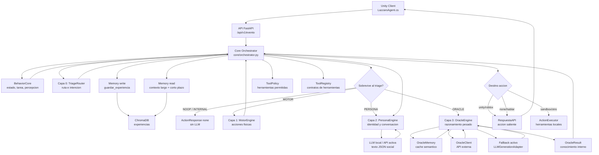

# Cognitive Contracts - TCM Lazzaro

Fecha de referencia: 2026-06-27

Este documento describe los contratos entre capas del TCM de Lazzaro
(`Triage Cognitive Multipaca`): que recibe cada capa, que devuelve, que
espera del resto del sistema, y que limites no debe cruzar.

La intencion es que este archivo funcione como mapa de integracion. Si una
capa cambia, primero debe actualizarse su contrato aqui y despues el codigo.

## Regla Principal

Las capas cooperan, pero ninguna se salta al Core.

El Core es la frontera de seguridad, continuidad, memoria, permisos y
normalizacion. Ninguna capa debe ejecutar herramientas criticas por su cuenta,
mutar estado global sin pasar por el orquestador, o hablar directamente con
Unity sin pasar por el contrato `RespuestaAPI`.

Regla de voz publica: solo Persona puede producir voz social final. Oraculo
produce conocimiento interno frio (`OracleResult`) y el Core debe pasarlo por
Persona antes de devolver cualquier `hablar` a Unity.

## Vista General



## Vocabulario Comun

### EventoEntrante

Contrato externo recibido por la API desde Unity, sandbox u otro cliente.

Archivo fuente: `api/schemas.py`

| Campo | Tipo | Obligatorio | Descripcion |
| --- | --- | --- | --- |
| `origen` | `roblox`, `unity`, `sandbox`, `otro` | Si | Cliente que genera el evento. |
| `tipo_evento` | `str` | Si | Tipo semantico del evento: `comando_usuario`, `actualizacion_estado`, `resultado_accion`, etc. |
| `id_transaccion` | `str` | Si | Idempotencia. Si se repite, el orquestador debe devolver la respuesta cacheada. |
| `timestamp` | `datetime` | No | Hora del evento. Si falta, se genera en servidor. |
| `objeto_involucrado` | `str` | No | Objeto principal asociado. Default: `ningun`. |
| `detalles` | `dict` | No | Payload flexible del cliente. |

Campos frecuentes dentro de `detalles`:

| Campo | Tipo esperado | Uso |
| --- | --- | --- |
| `mensaje` | `str` | Texto del usuario, manual inicial o mensaje critico. |
| `solicita_decision` | `bool` | Si es `true`, fuerza evaluacion activa aunque el evento no sea `comando_usuario`. Default logico: `false`. |
| `estado_fisico` | `dict` | Posicion, energia, movimiento, colisiones o estado Unity. |
| `estado_emocional` | `dict` | Estado emocional percibido o simulado. |
| `percepcion_visual` | `dict` | Resumen de percepcion entregado por Unity. |
| `resumen_percepcion` | `str` | Texto compacto de lo que Lazzaro ve. |
| `objetos_visibles` | `str` | Resumen textual de objetos visibles. |
| `objeto_mas_cercano` | `str` | Nombre del objeto mas cercano. |
| `accion` | `str` | Accion reportada en `resultado_accion`. |
| `exito` | `bool` | Resultado de accion ejecutada por el cliente. |
| `mensaje_resultado` | `str` | Explicacion del resultado. |
| `direccion_escape` | `dict` | Direccion sugerida por Unity ante dolor/choque. |
| `distancia_escape` | `float` | Distancia de escape ante interrupcion critica. |

### RespuestaAPI

Contrato externo devuelto por la API.

Archivo fuente: `api/schemas.py`

| Campo | Tipo | Descripcion |
| --- | --- | --- |
| `status` | `str` | Estado de la respuesta. Normalmente `ok` o error controlado. |
| `mensaje` | `str` | Mensaje resumen para el cliente. |
| `id_transaccion` | `str` | Id de transaccion original. |
| `accion` | `AccionSaliente` | Accion normalizada para Unity/sandbox. |
| `timestamp` | `datetime` | Hora de respuesta del servidor. |

### AccionSaliente

Contrato externo que Unity sabe interpretar.

Archivo fuente: `api/schemas.py` y `unity_client/DTOs.cs`

| Campo | Tipo | Descripcion |
| --- | --- | --- |
| `id_accion` | `str` | Identificador unico de accion. |
| `nombre` | `str` | Nombre de herramienta o accion: `hablar`, `none`, `navegar_a_objeto`, etc. |
| `parametros` | `dict` / `JObject` | Payload especifico de la accion. |
| `razonamiento` | `str` | Explicacion visible/tecnica corta. |
| `pensamiento_privado` | `str` | Pensamiento interno para depuracion o UI privada. |
| `requiere_confirmacion` | `bool` | Si debe pedir permiso antes de ejecutar. |
| `parametros_descripcion` | `str` | Descripcion legible de parametros, si aplica. |
| `emocion_facial` | `str` | Blend shape o emocion para VRM. |

### ActionResponse

Contrato interno usado por el orquestador antes de convertir a
`AccionSaliente`.

Archivo fuente: `ai_engine/schemas.py`

| Campo | Tipo | Descripcion |
| --- | --- | --- |
| `pensamiento` | `str` | Pensamiento interno normalizado. |
| `accion` | `str` | Nombre de accion interna. |
| `parametros` | `dict` | Parametros ya interpretados. |
| `razon` | `str` | Razon de la decision. |
| `valido` | `bool` | Si la accion es confiable. |
| `error` | `str | None` | Error controlado. No debe romper el flujo. |
| `emocion_facial` | `str | None` | Expresion facial sugerida. |
| `metadata` | `dict` | Metadata interna opcional, por ejemplo auditoria motora. No debe ser voz publica. |

Invariante importante: cualquier salida invalida, accion desconocida o payload
no ejecutable debe convertirse a una accion segura, normalmente `none` o
`hablar` con aclaracion.

Invariante de auditoria motora: si una respuesta viene de `MotorResolution`, el
Core debe preservar `metadata.motor_resolution` y `metadata.motor_audit`. Esa
metadata no debe convertirse en parametros fisicos para Unity ni en texto social
automatico.

### Decision de Triage

Contrato interno devuelto por `TriageRouter.route_event(...)`.

Archivo fuente: `ai_engine/triage_router.py`

| Campo | Tipo | Descripcion |
| --- | --- | --- |
| `intent` | `str` | Intencion detectada: `social`, `motor_simple`, `oracle`, etc. |
| `route` | `str` | Ruta final: `noop`, `internal`, `motor`, `persona`, `oracle`. |
| `confidence` | `float` | Confianza aproximada entre 0 y 1. |
| `requires_memory` | `bool` | Indica si la ruta podria beneficiarse de memoria. |
| `requires_oracle` | `bool` | Indica si la consulta requiere razonamiento pesado. |
| `reason` | `str` | Explicacion breve de por que se eligio la ruta. |

## Contrato De Capa 0: Triage

Responsabilidad: decidir si un evento merece procesamiento activo y a que ruta
debe ir.

No debe llamar LLM. No debe ejecutar herramientas. No debe escribir memoria.
No debe decidir personalidad. No debe mutar estado persistente.

### Entrada

`route_event(evento: dict, estado_agente: dict | None) -> dict`

El orquestador entrega:

| Entrada | Fuente | Descripcion |
| --- | --- | --- |
| `evento` | `EventoEntrante.model_dump(mode="python")` | Evento completo como diccionario Python. |
| `estado_agente` | `BehaviorCore` / `StateEngine` | Estado actual: movimiento, energia, estres, etc. |

### Salida

Una decision de triage con `intent`, `route`, `confidence`, `requires_memory`,
`requires_oracle` y `reason`.

### Rutas

| Ruta | Significado | Contrato |
| --- | --- | --- |
| `noop` | Evento pasivo o irrelevante | El Core debe devolver `none` sin LLM. |
| `internal` | Resultado interno o telemetria | El Core debe guardar memoria y devolver `none` sin LLM. |
| `motor` | Accion fisica o espacial | El Core puede consultar memoria y llamar `MotorEngine`. |
| `persona` | Conversacion/identidad | El Core puede consultar memoria y llamar `PersonaEngine`. |
| `oracle` | Consulta pesada/tecnica | El Core puede consultar memoria y llamar `OracleEngine`. |

### Reglas actuales

| Evento / Texto | Ruta esperada |
| --- | --- |
| `actualizacion_estado` | `noop` |
| `resultado_accion` | `internal` |
| `comando_usuario` social: `hola`, `como te llamas` | `persona` |
| `comando_usuario` motor: `camina`, `alejate`, `gira`, `interactua` | `motor` |
| `comando_usuario` tecnico: `codigo`, `arquitectura`, `debug`, `error` | `oracle` |
| Evento desconocido | `noop` seguro |
| Motor mientras `is_moving == true` | `noop` para evitar acumulacion |

### Contrato futuro para Random Forest

Cuando se reemplace parte del triage por modelo clasico, el dataset debe
conservar este contrato minimo:

```json
{
  "tipo_evento": "comando_usuario",
  "origen": "unity",
  "mensaje": "camina hacia la capsula",
  "estado_is_moving": false,
  "estado_energy_bucket": "alta|media|baja",
  "objetos_visibles_count": 2,
  "has_objeto_mas_cercano": true,
  "label_intent": "motor_simple",
  "label_route": "motor",
  "should_call_llm": false,
  "notes": "Comando motor ejecutable por MotorEngine"
}
```

El modelo puede sugerir ruta, pero las reglas duras siguen teniendo prioridad:
seguridad, eventos internos, errores absurdos, acciones peligrosas y no-op.

## Contrato Del Core / Orchestrator

Responsabilidad: coordinar todas las capas y convertir cualquier resultado en
una respuesta segura para el cliente.

Archivo fuente: `core/orchestrator.py`

### Entrada

`procesar_evento(evento: EventoEntrante) -> RespuestaAPI`

### Flujo obligatorio

1. Revisar idempotencia por `id_transaccion`.
2. Procesar evento en `BehaviorCore` para obtener estado, narrativa,
   percepcion y tarea.
3. Evaluar `TriageRouter`.
4. Decidir si el evento solicita decision activa.
5. Guardar experiencia en memoria para todos los eventos, incluso `noop` e
   `internal`.
6. Leer memoria de largo plazo y memoria de trabajo solo si el evento sobrevive
   al triage y requiere decision.
7. Filtrar herramientas con `ToolPolicy`.
8. Resolver ruta: interrupcion critica, motor, persona, oracle, fallback legacy
   o accion pasiva.
9. Sanitizar `ActionResponse`.
10. Convertir a `AccionSaliente`.
11. Gestionar ejecucion local o despacho al cliente.
12. Registrar accion reciente.
13. Cachear respuesta por transaccion.
14. Emitir notificaciones si aplica.
15. Registrar impacto en `IdentityState`.

### Invariantes

| Invariante | Motivo |
| --- | --- |
| Todo evento se guarda en memoria | El sueno/consolidacion necesita observaciones pasivas. |
| `noop` e `internal` no leen memoria vectorial | Ahorro de latencia y tokens. |
| `alerta_dolor_fisico` no espera al LLM | Seguridad inmediata. |
| Accion desconocida se convierte a `none` invalida | Evita comandos fantasma en Unity. |
| `resultado_accion` de `hablar` devuelve `none` | Evita bucles de voz. |
| `hablar` no requiere confirmacion desde Unity | Es salida pasiva. |
| Herramientas reales de escritorio requieren confirmacion | Seguridad fuera del jardin de Unity. |
| Solo Persona produce voz publica `hablar` | Oraculo debe devolver `OracleResult` interno, no `ActionResponse`. |

### Entrada que el Core espera de BehaviorCore

| Clave | Uso |
| --- | --- |
| `estado_actual` | Estado fisico/emocional para triage e identidad. |
| `narrativa` | Texto resumido del evento para memoria y prompts. |
| `contexto_llm` | Contexto base para ReasoningEngine legacy. |
| `tarea` | Objetivo actual. |
| `politica` | Politica de autonomia/confirmacion. |
| `es_interrupcion_critica` | Bypass de seguridad. |
| `tipo_memoria` | Clasificacion para `guardar_experiencia`. |
| `percepcion_resumida` | Resumen compacto de percepcion. |

### Salida que el Core garantiza

El Core siempre intenta devolver `RespuestaAPI`. En errores controlados, debe
preferir una accion segura:

```json
{
  "status": "ok",
  "mensaje": "accion generada",
  "accion": {
    "nombre": "none",
    "parametros": {},
    "razonamiento": "Evento filtrado por triage"
  }
}
```

## Contrato De BehaviorCore

Responsabilidad: transformar un evento bruto en estado narrativo y cognitivo.

Archivo fuente: `core/behavior_core.py`

### Entrada

| Entrada | Descripcion |
| --- | --- |
| `EventoEntrante` | Evento externo completo. |
| `detalles` | Fuente principal para percepcion, mensaje, resultados y estado fisico. |

### Salida

Un diccionario de contexto para el orquestador. Debe incluir estado actual,
narrativa, tarea, politica, banderas de seguridad y clasificacion de memoria.

### Lo que si puede hacer

- Actualizar estado del agente.
- Actualizar percepcion.
- Actualizar tarea cuando el evento es `comando_usuario` o
  `inicio_simulacion`.
- Construir narrativa para prompts y memoria.
- Clasificar eventos emocionales.
- Detectar interrupciones criticas.

### Lo que no debe hacer

- No debe llamar al LLM.
- No debe ejecutar herramientas.
- No debe decidir rutas de capa 0.
- No debe reiniciar tarea por `actualizacion_estado`.

## Contrato De Memoria

Responsabilidad: registrar experiencias, recuperar contexto relevante y
consolidar memoria durante descanso.

Archivos fuente principales:

- `memory/memory_manager.py`
- `memory/episodic_memory.py`
- `memory/semantic_memory.py`
- `memory/working_memory.py`
- `memory/conversation_memory.py`
- `memory/chroma_client.py`
- `ai_engine/oracle_memory.py`

### Escritura de memoria

El Core llama `guardar_experiencia(...)` para todos los eventos.

Entrada minima:

| Campo | Descripcion |
| --- | --- |
| `descripcion` | Narrativa del evento. |
| `tipo_evento` | Tipo de memoria clasificado. |
| `estado_emocional` | Estado al momento del evento. |
| `valencia` | Valor emocional aproximado. |
| `impacto` | Importancia calculada. |
| `metadata_extra` | Origen, objeto, estado fisico, accion, exito. |

Contrato: escribir memoria nunca debe bloquear indefinidamente el flujo. Si
falla, debe registrarse el error y el sistema debe seguir con una respuesta
segura.

### Lectura de memoria

El Core llama `obtener_contexto_memoria(...)` solo para eventos que sobreviven
al triage y requieren decision.

Tambien llama `obtener_ultimas_acciones()` para memoria de trabajo.

Formato inyectado al prompt:

```text
<continuidad conversacional reciente en RAM, si existe>

MEMORIA RELACIONAL PERSISTENTE:
<apodos, identidad del usuario/creador y preferencias claras, si existen>

MEMORIA DE TRABAJO OPERATIVA:
<acciones recientes de memoria de trabajo>

RECUERDOS A LARGO PLAZO:
<recuerdos relevantes desde Chroma>
```

### Memoria de trabajo

Responsabilidad: mantener acciones recientes para evitar repeticiones y dar
continuidad inmediata.

Contrato:

- Debe registrar accion, parametros y resultado.
- Debe ser compacta.
- Debe poder imprimirse como texto breve para prompts.

### Memoria conversacional RAM

Responsabilidad: mantener continuidad inmediata de dialogo sin consultar ni
escribir turnos completos en ChromaDB.

Contrato:

- Debe registrar pares `Usuario` / `Lazzaro` solo cuando la salida final sea
  `hablar`.
- Debe vivir solo en RAM y usar una cola circular pequena.
- Debe inyectarse antes de la memoria operativa y de los recuerdos largos.
- Debe destacar el ultimo intercambio, temas activos y senales de continuidad
  cuando el usuario use referencias como `eso`, `recuerdas` o `como te dije`.
- No debe ejecutarse para eventos `NOOP` o `INTERNAL` filtrados por Capa 0.

### Memoria relacional selectiva

Responsabilidad: persistir solo hechos conversacionales estables que ayuden a
la continuidad tras reinicios, sin convertir cada mensaje en memoria larga.

Contrato:

- Entrada: el mismo par `mensaje_usuario` / `respuesta_lazzaro` registrado por
  memoria conversacional.
- Salida: reglas semanticas `tipo_evento="memoria_relacional"` solo cuando hay
  una declaracion explicita de apodo, nombre, autoridad de creador/desarrollador
  o preferencia clara.
- Lectura: `obtener_contexto_relacional(...)` debe filtrar memoria semantica por
  `tipo_evento="memoria_relacional"` y devolver un bloque propio antes de la
  memoria operativa y de recuerdos generales.
- Vigencia: cada hecho relacional debe guardar `categoria_relacional`,
  `valor_relacional`, `estado_relacional` y `huella_conversacional`.
- Correcciones: si el usuario revoca un apodo o nombre, se registra un hecho
  `estado_relacional="revocado"` en la misma categoria; la lectura debe
  priorizar el hecho mas reciente por categoria.
- No debe guardar transcripciones completas del chat.
- Debe deduplicar hechos dentro del proceso y tambien consultar la huella en
  ChromaDB para evitar duplicados tras reinicios.
- Debe usar `guardar_regla(...)`, no `guardar_experiencia(...)`, porque estos
  hechos son conocimiento relacional estable y no telemetria episodica.

### Consolidacion / Sueno

Metodo publico: `consolidar_memorias_si_hace_falta()`.

Se activa desde el orquestador cuando se detecta descanso.

Contrato:

- Buscar memorias episodicas viejas y observacionales.
- Convertir patrones en memoria semantica.
- Evitar consolidar eventos criticos como si fueran ruido.
- Conservar suficiente contexto para que Lazzaro recuerde patrones pasivos del
  entorno.

### OracleMemory

Memoria especial para cache semantico del Oraculo.

Contrato:

- Entrada: pregunta del usuario y respuesta ya curada.
- Salida: respuesta cacheada si la distancia semantica esta bajo umbral.
- No reemplaza la memoria episodica normal.

## Contrato De Capa 1: Motor / Grounding Fisico / Herramientas

Responsabilidad: aterrizar lenguaje humano y percepcion cruda en acciones
fisicas seguras, auditables y compatibles con Unity.

Capa 1 no es una segunda Persona y no es una memoria paralela. Su trabajo es
decidir a que objeto real se refiere el usuario, validar si la accion aplica a
ese objeto, bloquear ejecuciones inseguras y devolver una salida estructurada.
Capa 2 verbaliza. Capa 3 recuerda. Capa 0 enruta. El Core conserva el flujo y
los permisos.

Archivos fuente:

- `ai_engine/motor_engine.py`
- `ai_engine/motor_schemas.py`
- `ai_engine/affordance_resolver.py`
- `core/tool_policy.py`
- `tools/registry.py`
- `tools/executor.py`
- `tools/simulated/*.py`
- `tools/real/*.py`
- `unity_client/MovementController.cs`
- `unity_client/PerceptionSystem.cs`

### Entrada a MotorEngine

| Entrada | Tipo | Descripcion |
| --- | --- | --- |
| `mensaje_usuario` | `str` | Comando motor del usuario. |
| `intent` | `str` | Intencion normalizada por Capa 0, por ejemplo `MOTOR_SIMPLE`, `MOTOR_REFERENCE`, `PERCEPTION` o `INTERACTION`. |
| `herramientas_disponibles` | `list[str]` | Herramientas permitidas por ToolPolicy. |
| `percepcion_resumida` | `dict | str` | Formato legacy de Unity: objetos visibles, objeto cercano, posicion. |
| `percepcion_normalizada` | `PerceptionSnapshot | None` | Formato canonico nuevo, derivado desde Unity, escritorio, OCR o UI-tree. |

La compatibilidad legacy con Unity se conserva. Si Unity envia nombres como
`nombre_objeto` o resumen textual, un adaptador Python debe traducir esa entrada
a `PerceivedObject` antes de que el resolver fuzzy haga scoring. El contrato
externo hacia Unity puede seguir usando `nombre_objeto`; internamente Capa 1 debe
resolver a `target_id` y conservar la traduccion `target_id -> display_name ->
nombre_objeto` en auditoria.

### PerceptionSnapshot y PerceivedObject

Todo origen perceptivo debe normalizarse al mismo contrato antes de resolver
targets. Unity es el primer origen, pero el formato debe servir despues para
escritorio, OCR y UI-tree.

```python
@dataclass
class PerceivedObject:
    id: str
    display_name: str
    aliases: list[str]
    position: dict | None
    screen_position: dict | None
    distance: float | None
    affordances: list[str]
    source: str
    confidence: float = 1.0
```

```python
@dataclass
class PerceptionSnapshot:
    snapshot_id: str
    objects: list[PerceivedObject]
    source: str
    raw: dict | str | None = None
```

Reglas:

- `source` debe ser `unity`, `desktop`, `ocr` o `ui_tree`.
- Un string legacy como `Frente a mi veo: Cube, Sphere` debe convertirse a
  objetos normalizados con `source="unity"` y confianza conservadora.
- `snapshot_id` debe existir cuando el origen pueda proveerlo; si no existe, el
  adaptador puede derivarlo de contenido y tiempo para cache local.
- `confidence` perceptiva no autoriza acciones por si sola; solo participa como
  componente auditado del scoring.

### Salida de MotorEngine

Diccionario compatible con `ActionResponse`:

| Campo | Tipo | Descripcion |
| --- | --- | --- |
| `accion` | `str` | Accion motora validada o `hablar`/`none`. |
| `parametros` | `dict` | Parametros validados por schema Pydantic. |
| `pensamiento` | `str` | Diagnostico interno. |
| `razon` | `str` | Por que se eligio la accion. |
| `valido` | `bool` | Si es ejecutable. |
| `error` | `str | None` | Error controlado. |
| `metadata.motor_resolution` | `dict | None` | Estado estructurado de Capa 1, sin voz social. |
| `metadata.motor_audit` | `dict | None` | Metadata obligatoria para depurar decisiones fuzzy. |

`metadata.motor_resolution` y `metadata.motor_audit` son internos. Pueden viajar
por el objeto devuelto por MotorEngine y por logs del Core, pero no deben
convertirse en parametros fisicos para Unity. Unity recibe solo la accion y
parametros que su contrato entiende.

### MotorResolution

Toda resolucion de objetivo debe producir un estado explicito. Los estados viven
en `MotorResolution`; la metadata de por que se llego a ellos viaja en
`metadata.motor_audit`.

| Estado | Significado | Salida esperada |
| --- | --- | --- |
| `ready` | Objeto y accion suficientemente claros. | Accion fisica validada por `motor_schemas.py`. |
| `requires_clarification` | Hay candidatos plausibles pero no seguros. | Aclaracion directa y tecnica; no ejecutar. |
| `not_found` | No hay candidato razonable. | `hablar` seguro: no veo/no encuentro ese objeto. |
| `not_allowed` | La accion no aplica al objeto o affordance. | `hablar` seguro: ese objeto no permite esa accion. |
| `unsafe` | La accion seria riesgosa o contradice el estado fisico. | `none` o negativa breve; no ejecutar. |

Campos minimos esperados:

| Campo | Tipo | Descripcion |
| --- | --- | --- |
| `status` | `str` | Uno de los estados anteriores. |
| `action` | `str | None` | Accion candidata, por ejemplo `navegar_a_objeto`. |
| `target_id` | `str | None` | Identificador interno del objeto elegido. |
| `target_display_name` | `str | None` | Nombre visible/humano del objeto elegido. |
| `legacy_nombre_objeto` | `str | None` | Nombre compatible con Unity cuando aplique. |
| `confidence` | `float` | Score final normalizado. |
| `candidates` | `list[CandidateMatch]` | Maximo 3 candidatos relevantes para ready/aclaracion. |
| `reason` | `str` | Razon tecnica breve, no voz de Persona. |
| `audit` | `dict` | Scores, thresholds, candidatos rechazados y reglas aplicadas. |

### Auditoria Obligatoria

Cada decision fuzzy debe dejar rastro suficiente para explicar si Lazzaro fue
demasiado permisiva, demasiado conservadora o confundio objetos parecidos.

Campos minimos:

| Campo | Descripcion |
| --- | --- |
| `query` | Texto original usado para resolver el target. |
| `normalized_query` | Texto normalizado antes de scoring. |
| `intent` | Intencion usada para seleccionar thresholds. |
| `snapshot_id` | Snapshot perceptivo usado o `None`. |
| `threshold_execute` | Umbral de ejecucion aplicado. |
| `threshold_clarify` | Umbral de aclaracion aplicado. |
| `score_components` | `name_score`, `alias_score`, `affordance_score`, `context_bonus`, `risk_penalty`, `final_score`. |
| `selected_candidate` | Candidato elegido o `None`. |
| `rejected_candidates` | Candidatos descartados con razon. |
| `status_reason` | Regla que produjo `ready`, `requires_clarification`, `not_found`, `not_allowed` o `unsafe`. |

Log recomendado:

```text
FUZZ_DECISION query="roca" intent=MOTOR_SIMPLE status=requires_clarification best=Rock_01 score=77 candidates=[Rock_01:77, Rock_02:74]
```

### Scoring Fuzzy

`thefuzz` queda autorizado para el matching de nombres y aliases. No debe correr
en loops de frame ni en `Update`; solo en comandos de usuario, consultas
perceptivas, validacion de parametros o revalidacion de acciones propuestas por
LLM.

Formula inicial:

```text
final_score = name_score * 0.50 + alias_score * 0.20 + affordance_score * 0.20 + context_bonus * 0.10 - risk_penalty
```

El score final no basta por si solo: si hay riesgo fisico, affordance ausente o
ambiguedad estrecha, el estado debe ser conservador.

Umbrales iniciales:

| Intent | Ejecutar | Aclarar | Razon |
| --- | --- | --- | --- |
| `MOTOR_SIMPLE` | `88+` | `68-87` | Moverse requiere precision alta. |
| `MOTOR_REFERENCE` | `82+` | `60-81` | Referencias como `eso` aceptan mas contexto, no menos auditoria. |
| `PERCEPTION` | `65+` | `45-64` | Describir es menos riesgoso que actuar. |
| `INTERACTION` | `90+` | `72-89` | Tocar, usar o agarrar tiene mas riesgo fisico. |
| `DESKTOP_FUTURE` | `92+` | `80-91` | Un clic equivocado puede ser caro. |

Regla de ambiguedad: si dos candidatos estan dentro de 8 puntos de diferencia y
ambos superan el umbral de aclaracion, el estado debe ser
`requires_clarification`. No se ejecuta.

### Diagnosticos motores legacy

| Diagnostico | Respuesta esperada |
| --- | --- |
| `sin_intencion` | Dejar que otra capa maneje o devolver `none`. |
| `no_permitida` | Pedir aclaracion o negar accion no disponible. |
| `falta_objetivo` | Devolver `hablar`: "Dime a que objeto quieres que vaya." |
| `ambigua` | Devolver `hablar` pidiendo objetivo concreto. |
| `lista` | Devolver accion fisica validada. |

Estos diagnosticos se mantienen para compatibilidad con el motor actual. El
rework debe mapearlos gradualmente a `MotorResolution` sin romper tests viejos.

### Clarificaciones

La decision de no estar seguro pertenece a Capa 1. En la primera fase, la salida
de aclaracion debe ser directa, estandarizada y tecnica:

```text
Veo Rock_01 y Rock_02. Cual quieres?
```

Persona no debe interpretar objetivos ni decidir targets. Si se usa Persona para
verbalizar una aclaracion, debe recibir una instruccion corta de estilo tecnico y
solo cambiar tono superficial, no la decision.

### Affordances Cerradas

Capa 1 usa una ontologia cerrada de affordances. Unity no debe enviar tags libres
como contrato cognitivo final. Si llegan valores desconocidos, el validador debe
marcarlos como `unknown_affordance` en logs/auditoria y no contarlos para scoring.

Affordances permitidas iniciales:

| Categoria | Valores |
| --- | --- |
| Movimiento | `obstaculo`, `transitable`, `bloquea_paso`, `punto_refugio` |
| Interaccion | `mirar`, `tocar`, `agarrable`, `empujable`, `activable`, `inspeccionable` |
| Utilidad | `da_sombra`, `cubre`, `ilumina`, `descanso`, `peligro`, `recurso` |
| Escritorio futuro | `clicable`, `escribible`, `arrastrable`, `ventana`, `boton`, `campo_texto` |

`AffordanceResolver` valida si una accion aplica al objeto seleccionado. Ejemplos:

- `agarrar_objeto` requiere `agarrable`.
- `interactuar_objeto_3d` con `mirar` permite `mirar` o `inspeccionable`.
- Un objeto con `peligro` puede aumentar `risk_penalty`.
- `da_sombra` o `cubre` puede resolver consultas como "algo para cubrirme", pero
  no debe forzar acciones autonomas.

### Acciones motoras actuales

| Accion | Parametros minimos | Descripcion |
| --- | --- | --- |
| `navegar_a_objeto` | `nombre_objeto` | Ir hacia un objeto visible o localizable. |
| `navegar_a_posicion` | `x`, `y`, `z` | Ir a una posicion del mundo. |
| `alejarse_de_objeto` | `nombre_objeto`, `distancia` | Alejarse de un objeto. |
| `girar_avatar` | `grados` | Rotar en grados sobre eje Y. |
| `interactuar_objeto_3d` | `nombre_objeto`, `tipo_accion` | Tocar, inspeccionar, activar, etc. |
| `agarrar_objeto` | `nombre_objeto` | Agarrar objeto cercano. |
| `soltar_objeto` | Opcional | Soltar objeto actualmente agarrado. |
| `aplicar_fuerza` | `nombre_objeto`, vector/intensidad | Empujar o aplicar fuerza. |
| `hablar` | `texto_a_comunicar` | Aclaracion segura cuando no se puede actuar. |
| `none` | Ninguno | No actuar. |

Todas las acciones fisicas pasan por `motor_schemas.py` como ultimo filtro antes
de salir a Unity. Ningun target fuzzy puede saltarse los schemas.

### Limites Anti-Spaghetti

Reglas no negociables:

- Capa 1 no escribe directo a ChromaDB.
- Capa 1 no llama LLM dentro del resolver fuzzy.
- Capa 1 no ejecuta `thefuzz` en loops de frame, `Update` o telemetria pasiva.
- Capa 1 no decide persistencia de aliases aprendidos; solo emite candidatos.
- Persona no decide targets fisicos.
- Memoria puede aportar contexto acotado, pero no reemplaza la decision de Capa 1.
- El sesgo por estado interno no puede dominar nombre, alias, affordance ni
  seguridad.
- Si hay duda, se aclara. Si hay riesgo, `none`. Si esta claro, accion validada.

### Contrato de ToolPolicy

`ToolPolicy` decide que herramientas puede ver cada ruta y origen.

Reglas actuales:

- `persona` solo puede ver `hablar`.
- `oracle` no recibe herramientas publicas. Si una politica legacy lo consulta,
  como maximo expone `hablar`, pero `OracleEngine` no debe usarlo ni devolverlo.
- `unity` y `roblox` solo pueden recibir herramientas seguras del jardin 3D.
- `sandbox` y `otro` pueden usar mas herramientas, pero las reales deben
  requerir confirmacion.

### Contrato de ToolRegistry

El registro debe exponer:

| Campo | Uso |
| --- | --- |
| `func` | Funcion Python ejecutable. |
| `description` | Texto descriptivo para prompts o docs. |
| `schema` | Pydantic schema para validar parametros. |
| `requires_confirmation` | Seguridad antes de ejecutar. |

`listar_nombres()` debe devolver los nombres registrados.

### Contrato de ActionExecutor

Solo ejecuta acciones locales cuando el destino es `sandbox` u `otro`.

No debe ejecutar acciones que requieren confirmacion si la accion saliente no
la trae marcada.

### Contrato Unity para motor

Unity recibe `AccionSaliente` y ejecuta:

| Accion | Script Unity | Comportamiento |
| --- | --- | --- |
| `navegar_a_objeto` | `MovementController.cs` | Busca objeto con `PerceptionSystem` y usa NavMesh. |
| `navegar_a_posicion` | `MovementController.cs` | Valida posicion en NavMesh y navega. |
| `alejarse_de_objeto` | `MovementController.cs` | Calcula punto opuesto y navega. |
| `girar_avatar` | `MovementController.cs` | Rota el avatar por grados. |
| `interactuar_objeto_3d` | `LazzaroAgent.cs` | Verifica objeto y distancia antes de reportar exito. |
| `agarrar_objeto` | `LazzaroAgent.cs` | Verifica objeto cercano antes de reportar exito. |
| `hablar` | `LazzaroAgent.cs` | Muestra voz/UI, no reporta `resultado_accion`. |

Invariante Unity: una accion fisica completada o fallida puede reportar
`resultado_accion`; `hablar` no debe reportarlo para evitar loops.

## Contrato De Capa 2: Persona

Responsabilidad: voz social, identidad, tono, continuidad relacional y
expresion emocional.

Archivo fuente: `ai_engine/persona_engine.py`

### Entrada

`preparar_interaccion(mensaje_usuario, identity_state, percepcion, recuerdos)`

| Entrada | Descripcion |
| --- | --- |
| `mensaje_usuario` | Texto social o relacional. |
| `identity_state` | Energia, estres, foco y reglas biologicas. |
| `percepcion` | Resumen del entorno para hablar con contexto. |
| `recuerdos` | Memoria de trabajo + memoria de largo plazo. |

### Salida hacia LLM

Lista de mensajes estilo chat:

| Rol | Contenido |
| --- | --- |
| `system` | Identidad, restricciones, biologia, formato JSON estricto. |
| `user` | Mensaje del usuario y contexto permitido. |

### Salida esperada del LLM

JSON estricto con esta forma:

```json
{
  "pensamiento_privado": "resumen interno corto",
  "accion": "hablar",
  "parametros": {
    "texto_a_comunicar": "respuesta visible"
  },
  "razon": "motivo breve",
  "emocion_facial": "neutral"
}
```

### Contrato del parser social

`parsear_respuesta(texto_crudo)` debe:

- Tolerar Markdown, texto antes/despues del JSON y etiquetas tipo `<think>`.
- Intentar rescatar `texto_a_comunicar` de JSON truncado.
- Forzar cualquier accion distinta de `hablar` a `hablar`.
- Limitar tamanos de texto para no inflar respuestas.
- Marcar `requiere_reintento` cuando la salida esta vacia o irrecuperable.
- Nunca entregar una accion fisica directa.

### Retry barato

El Core puede hacer un unico reintento si Persona devuelve salida vacia o
irrecuperable.

Contrato del retry:

- Prompt minimo.
- Temperatura baja.
- Limite corto de tokens.
- Si falla, fallback seguro con `hablar`.

### Biologia / IdentityState

Persona recibe condiciones de `IdentityState.inyectar_en_prompt(...)`.

Ejemplos de reglas esperadas:

| Estado | Condicion narrativa |
| --- | --- |
| Energia baja | Respuestas mas cortas, cansancio o baja bateria. |
| Estres alto | Tono mas tenso o irritable, sin perder seguridad. |
| Foco bajo | Pedir claridad y evitar tareas complejas. |
| Descanso | Reducir actividad y consolidar memoria. |

### Contrato futuro para modelo propio

Cuando Capa 2 use un modelo local entrenado:

- Debe conservar el mismo JSON de salida.
- Debe mantener `accion="hablar"` por defecto.
- Puede sugerir acciones no criticas, pero el Core decide si se ejecutan.
- Debe recibir identidad, memoria relacional y estado biologico.
- No debe reemplazar a Triage ni a MotorEngine.

Ejemplo de dataset:

```json
{
  "input": {
    "mensaje_usuario": "hola, como te sientes?",
    "estado": {"energia": 57, "estres": 20, "foco": 80},
    "percepcion": "Veo una capsula a 3m",
    "recuerdos": "El usuario suele llamarme Lazz."
  },
  "output": {
    "pensamiento_privado": "El usuario abre conversacion social.",
    "accion": "hablar",
    "parametros": {"texto_a_comunicar": "Estoy aqui, algo cansada pero estable."},
    "razon": "Responder socialmente sin accionar herramientas.",
    "emocion_facial": "neutral"
  }
}
```

## Contrato De Capa 3: Oraculo

Responsabilidad: razonamiento pesado, analisis tecnico, arquitectura, codigo,
debugging, explicaciones complejas y consultas que exceden a Persona.

Regla critica: Oraculo es una capa fria. No produce voz publica, no devuelve
`ActionResponse`, no decide `hablar` y no genera payload final para Unity.

Archivos fuente:

- `ai_engine/oracle_engine.py`
- `ai_engine/oracle_client.py`
- `ai_engine/oracle_memory.py`
- `ai_engine/llm_generation_adapter.py`
- `ai_engine/schemas.py`

### Entrada

| Entrada | Descripcion |
| --- | --- |
| `mensaje_usuario` | Pregunta compleja o tecnica. |
| `oracle_memory` | Cache semantico de consultas previas. |
| `oracle_client` | API externa si esta configurada. |
| `llm_adapter` | Fallback activo usado por el Core si API externa falla. |

### Flujo

1. `Orchestrator._resolver_ruta_oracle(...)` recibe la ruta `oracle`.
2. `OracleEngine.evaluar_cache(mensaje_usuario, oracle_memory)` intenta un cache hit.
3. Si hay hit, se obtiene `OracleResult(fuente="cache", cache_hit=True)`.
4. Si no hay hit, `OracleEngine.preparar_consulta(mensaje_usuario)` crea el prompt frio.
5. El Core intenta `OracleClient.consultar_oraculo(...)` si esta configurado.
6. Si API externa falla o no existe, el Core usa `LLMGenerationAdapter` como fallback activo.
7. `OracleEngine.keep_y_save(...)` normaliza la salida cruda, guarda cache y devuelve `OracleResult`.
8. El Core llama `PersonaEngine.preparar_verbalizacion_oraculo(...)`.
9. Persona verbaliza el conocimiento interno y solo entonces se produce `ActionResponse(accion="hablar")`.

### Salida De Oraculo

`OracleResult` con:

| Campo | Valor esperado |
| --- | --- |
| `pregunta_original` | Texto original del usuario. |
| `contenido_tecnico` | Conocimiento frio, explicacion, diagnostico o codigo. |
| `resumen_para_persona` | Resumen opcional para facilitar verbalizacion social. |
| `fuente` | `api`, `cache`, `fallback` o `error`. |
| `cache_hit` | `true` solo cuando viene de `OracleMemory`. |
| `error` | Error interno si la consulta tuvo fallo recuperable. |

### Salida Publica Final

La salida publica no pertenece a Oraculo. La genera Persona despues de recibir
`OracleResult`. El Core debe rechazar como deuda arquitectonica cualquier flujo
que convierta Oraculo directamente en `ActionResponse`.

### Limites

- Oraculo no es la identidad principal.
- Oraculo no debe ejecutar herramientas directamente.
- Oraculo no debe hablar directo con Unity.
- Oraculo no debe devolver `accion`, `hablar`, `texto_a_comunicar` ni parametros de Unity.
- Oraculo puede generar conocimiento o payloads sugeridos, pero el Core/Persona valida la salida publica.
- Oraculo debe usar cache para reducir costo.

## Contrato De ReasoningEngine Legacy

Responsabilidad: fallback general mientras las capas especializadas terminan de
absorber casos antiguos.

Archivos fuente:

- `ai_engine/reasoning_engine.py`
- `ai_engine/prompt_builder.py`
- `ai_engine/response_parser.py`
- `ai_engine/tool_router.py`

### Entrada

| Entrada | Descripcion |
| --- | --- |
| `evento` | Evento original. |
| `contexto` | `AgentContext` con estado, memoria, herramientas y politica. |
| `herramientas` | Lista filtrada por `ToolPolicy`. |

### Salida

`ActionResponse` parseado y normalizado.

### Limite estrategico

El uso de esta capa debe disminuir con el tiempo. Motor, Persona y Oraculo
deben cubrir cada vez mas casos para que el fallback quede como red de
seguridad, no como cerebro principal.

## Contrato Del Cliente Unity

Responsabilidad: simular el jardin de aprendizaje, enviar eventos compactos y
ejecutar acciones fisicas seguras.

Archivos fuente:

- `unity_client/LazzaroAgent.cs`
- `unity_client/ApiClient.cs`
- `unity_client/DTOs.cs`
- `unity_client/PerceptionSystem.cs`
- `unity_client/MovementController.cs`

### Eventos que Unity envia

| Evento | Cuando se envia | Debe solicitar decision? |
| --- | --- | --- |
| `inicio_simulacion` | Al iniciar escena | Si, solo una vez. |
| `comando_usuario` | Entrada humana | Si. |
| `actualizacion_estado` | Cambio significativo pasivo | No, salvo excepcion explicita. |
| `resultado_accion` | Accion fisica terminada/fallida | No por defecto. |
| `alerta_dolor_fisico` | Choque/dolor/interrupcion | Si, ruta critica. |

### Reglas de Unity

- `inicio_simulacion` puede enviar el manual espacial.
- `actualizacion_estado` no debe reenviar el manual espacial.
- `hablar` no debe reportar `resultado_accion`.
- Movimiento activo debe omitir escaneo pasivo.
- La cola de tareas debe procesar una subtarea a la vez.
- Si una subtarea falla, la secuencia puede cancelarse para evitar cascadas.
- Interacciones con objetos deben validar existencia y distancia antes de
  reportar exito.

### Percepcion

`PerceptionSystem.EscanearEntorno()` debe devolver percepcion compacta.

Campos esperados:

| Campo | Descripcion |
| --- | --- |
| `snapshot_id` | Identificador estable del snapshot perceptivo para cache local. |
| `source` | Origen perceptivo, inicialmente `unity`. |
| `objetos_visibles` | Resumen textual, no lista gigante. |
| `objetos_normalizados` | Lista compacta de objetos compatibles con `PerceivedObject`. |
| `resumen_percepcion` | Lenguaje natural compacto. |
| `cantidad_objetos_visibles` | Conteo. |
| `posicion_lazzaro` | Posicion actual. |
| `objeto_mas_cercano` | Objeto relevante mas cercano. |
| `unknown_affordances` | Valores rechazados por la ontologia cerrada de affordances. |

### Movimiento

`MovementController` debe disparar:

`OnMovimientoCompletado(bool exito, string mensaje)`

Esto permite a `LazzaroAgent` reportar resultados fisicos sin confirmar
acciones pasivas como `hablar`.

## Contrato De Proveedores LLM

Responsabilidad: generar texto para Persona, Oraculo o ReasoningEngine sin que
el Core dependa de un proveedor unico.

Archivos fuente:

- `ai_engine/client_factory.py`
- `ai_engine/fallback_ai_client.py`
- `ai_engine/llm_generation_adapter.py`
- `ai_engine/ollama_client.py`
- `ai_engine/gemini_client.py`
- `ai_engine/openai_compatible_client.py`

### Entrada comun

| Campo | Descripcion |
| --- | --- |
| `prompt` o `mensajes` | Texto final ya construido por la capa. |
| `policy` | Politica de generacion desde `LLMPolicyManager`. |
| `max_tokens` | Limite por capa. |
| `temperature` | Temperatura por capa. |
| `response_mime_type` | Para texto social/oraculo normalmente `text/plain`. |

### Salida comun

Texto crudo. La capa que llamo al LLM es responsable de parsear, limpiar y
normalizar.

### Reglas

- El proveedor no decide herramientas.
- El proveedor no decide ruta.
- Si un proveedor falla o devuelve vacio, `FallbackAIClient` puede intentar el
  siguiente.
- Persona y Oraculo deben tener limites de tokens distintos.

## Contrato De Herramientas

Cada herramienta debe tener un contrato Pydantic claro.

### Forma recomendada

```python
@register_tool(
    name="nombre_herramienta",
    description="Descripcion breve",
    schema=ParamsModel,
    requires_confirmation=False,
)
def herramienta(params: ParamsModel) -> ToolResult:
    ...
```

### Reglas

- Parametros invalidos deben fallar antes de ejecutar.
- Herramientas reales de escritorio deben requerir confirmacion.
- Herramientas simuladas de Unity deben coincidir con acciones que Unity puede
  entender.
- Una herramienta no debe hablar como Persona; solo devuelve resultado tecnico.

## Matriz Rapida De Contratos

| Capa | Recibe | Devuelve | No debe hacer |
| --- | --- | --- | --- |
| API | JSON externo | `RespuestaAPI` | Razonar o ejecutar herramientas. |
| BehaviorCore | `EventoEntrante` | Contexto de estado | Llamar LLM o tools. |
| Triage | Evento dict + estado | Ruta/intencion | Escribir memoria o ejecutar. |
| Core | Evento + contexto | Respuesta segura | Saltarse permisos o cache. |
| Memoria | Experiencias/consultas | Recuerdos/contexto | Decidir acciones. |
| Motor | Comando fisico + percepcion | Accion validada | Inventar personalidad. |
| Persona | Mensaje social + identidad | `hablar` | Ejecutar tools criticas. |
| Oraculo | Consulta compleja | `OracleResult` interno | Actuar como identidad principal o devolver `ActionResponse`. |
| ToolPolicy | Origen/ruta/tools | Tools permitidas | Ejecutar tools. |
| ToolRegistry | Decoradores | Catalogo | Decidir rutas. |
| ActionExecutor | Accion local | Resultado local | Ejecutar sin confirmacion requerida. |
| Unity | `AccionSaliente` | Eventos/resultados | Confirmar `hablar`. |

## Casos De Prueba Por Contrato

### Triage

- `actualizacion_estado` devuelve `noop`.
- `resultado_accion` devuelve `internal`.
- `hola` devuelve `persona`.
- `camina hacia la capsula` devuelve `motor`.
- `explicame este error de codigo` devuelve `oracle`.
- Evento desconocido devuelve `noop`.

### Core

- `noop` guarda experiencia y no lee memoria.
- `internal` guarda experiencia y no llama LLM.
- `alerta_dolor_fisico` genera accion de escape sin LLM.
- `resultado_accion` de `hablar` devuelve `none`.
- Accion desconocida se sanitiza a `none`.

### Motor

- `camina al cubo` devuelve `navegar_a_objeto`.
- `alejate del cubo` devuelve `alejarse_de_objeto`.
- `gira 180` devuelve `girar_avatar`.
- `camina` devuelve `hablar` pidiendo objetivo.
- Objeto inexistente no debe convertirse en exito falso.
- `camina a la spehre` puede resolver `Sphere` solo si supera threshold.
- `ve a la roca` con `Rock_01` y `Rock_02` cercanos en score devuelve
  `requires_clarification`.
- `busca algo para cubrirte` puede elegir un objeto con `cubre` o `da_sombra`,
  no un match literal inventado.
- `agarra el arbol` devuelve `not_allowed` si el arbol no tiene `agarrable`.
- Cualquier resolucion fuzzy incluye `metadata.motor_audit` con componentes de
  score, thresholds y candidatos rechazados.
- Affordances fuera de la lista cerrada se registran como `unknown_affordance` y
  no suman score.
- Capa 1 no escribe directo a ChromaDB cuando genera candidatos de alias.

### Persona

- JSON con Markdown se parsea.
- JSON truncado con `texto_a_comunicar` recuperable se rescata.
- Accion fisica emitida por el LLM se fuerza a `hablar`.
- Texto vacio provoca retry barato.
- Segundo fallo provoca fallback seguro.

### Oraculo

- Pregunta cacheada devuelve `OracleResult` sin llamar API externa.
- Falla de API externa usa fallback activo y devuelve `OracleResult`.
- `OracleEngine` nunca devuelve `ActionResponse`.
- Ruta `oracle` del Core llama a Persona antes de responder a Unity.
- Persona verbaliza `OracleResult` como `hablar`.
- Conocimiento frio se guarda en `OracleMemory`.

### Unity

- `hablar` no envia `resultado_accion`.
- Movimiento completado si envia `resultado_accion`.
- Movimiento activo omite escaneo pasivo.
- Interaccion lejana reporta fallo, no exito.
- Cola de tareas no ejecuta dos subtareas fisicas a la vez.

## Riesgos Conocidos

| Riesgo | Impacto | Mitigacion prevista |
| --- | --- | --- |
| Triage por keywords todavia es fragil | Rutas equivocadas | Dataset + Random Forest gradual. |
| Persona depende de proveedor LLM | Tono variable | Modelo local propio de Capa 2. |
| ReasoningEngine legacy puede reintroducir alucinaciones | Acciones raras | Reducir su uso y endurecer sanitizacion. |
| Escritura Chroma puede ser costosa | Latencia | Futura cola/asinc/batch de memoria. |
| Unity y Python pueden divergir en nombres de acciones | Acciones no ejecutables | Mantener esta doc + tests de contrato. |
| Herramientas de escritorio aumentan riesgo | Seguridad | Confirmacion obligatoria y permisos por origen. |

## Checklist Para Cambios Futuros

Antes de agregar una accion nueva:

1. Definir schema Pydantic en Python.
2. Registrar herramienta en `tools/simulated` o `tools/real`.
3. Agregar permiso en `ToolPolicy` si aplica.
4. Agregar parsing en `MotorEngine` si es accion motora.
5. Agregar ejecucion en Unity si el origen es `unity`.
6. Agregar pruebas de contrato.
7. Actualizar este documento.

Antes de cambiar una ruta:

1. Actualizar `routing_rules.py` o el futuro modelo de Triage.
2. Confirmar que el evento sigue guardandose en memoria.
3. Confirmar que solo rutas activas leen memoria.
4. Confirmar que no se rompe `alerta_dolor_fisico`.
5. Actualizar pruebas y bitacora.

Antes de cambiar Persona:

1. Mantener salida JSON compatible.
2. Mantener `accion="hablar"` por defecto.
3. Mantener parser tolerante.
4. Mantener retry barato.
5. Confirmar que no ejecuta herramientas criticas.

Antes de cambiar Oraculo:

1. Mantener cache semantico.
2. Mantener fallback.
3. Mantener salida fria `OracleResult`.
4. No devolver `ActionResponse` desde Capa 3.
5. No mezclar voz de identidad principal con respuesta tecnica sin pasar por
   Core/Persona.

## Principio De Evolucion

El sistema debe crecer por contratos, no por atajos.

La direccion actual es:

- Capa 0: reglas duras + clasificador entrenado.
- Capa 1: mas herramientas seguras y mejor simulacion Unity/escritorio.
- Capa 2: modelo propio de personalidad local.
- Capa 3: API pesada solo para consultas complejas.
- Core: frontera estable de seguridad, memoria, continuidad y permisos.

Si una mejora rompe este principio, probablemente pertenece a otra capa o
necesita un contrato nuevo antes de tocar codigo.
